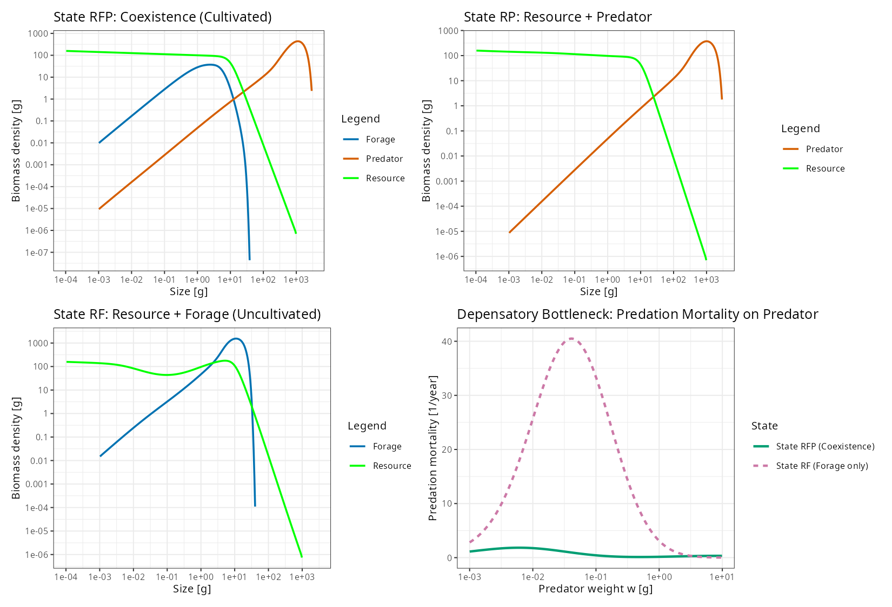
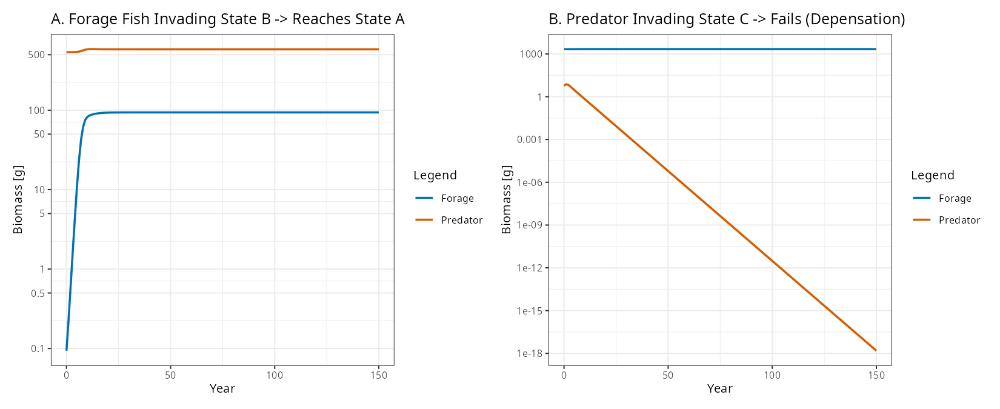
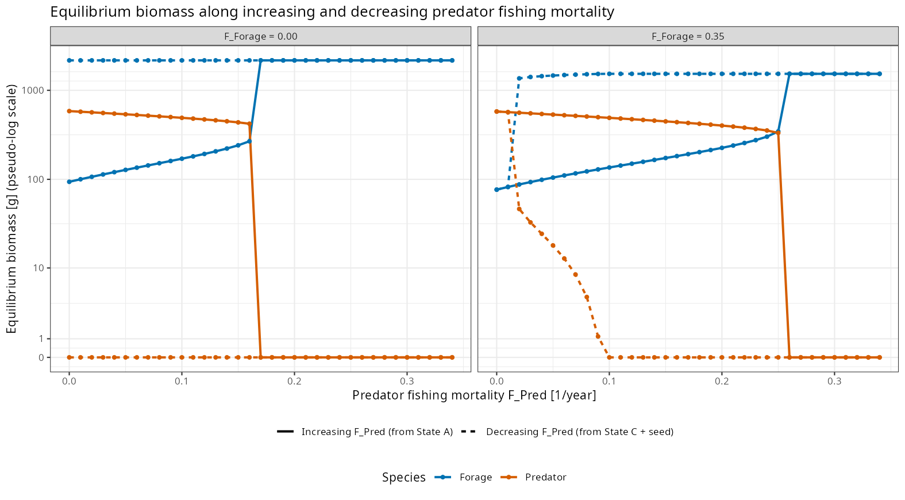
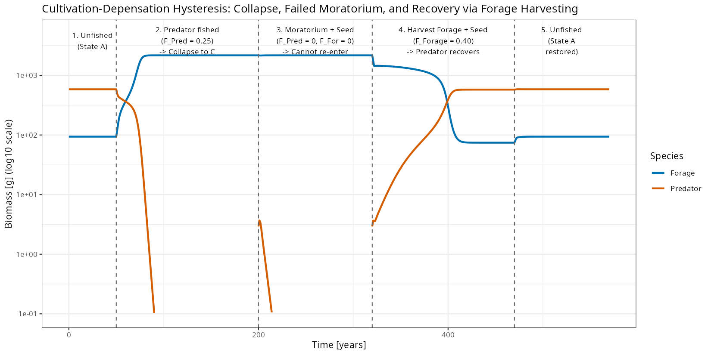
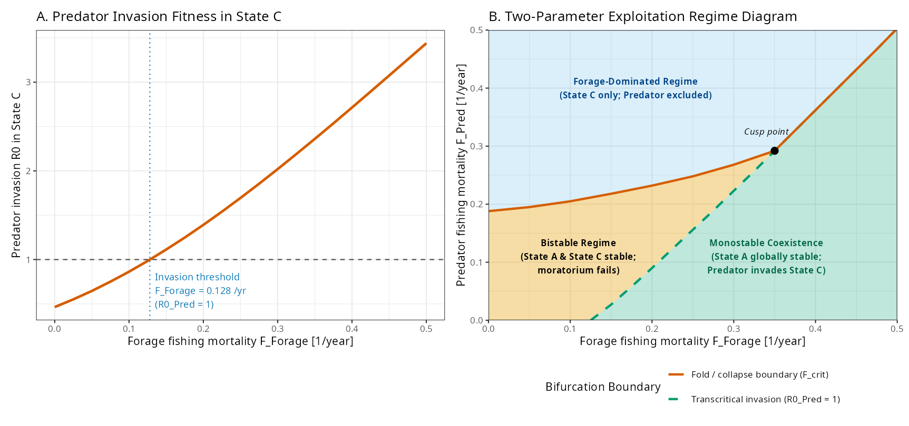
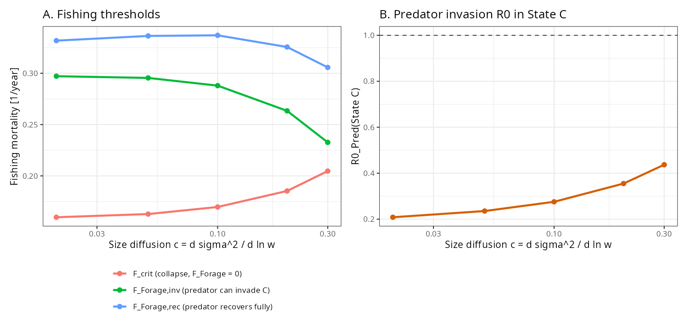
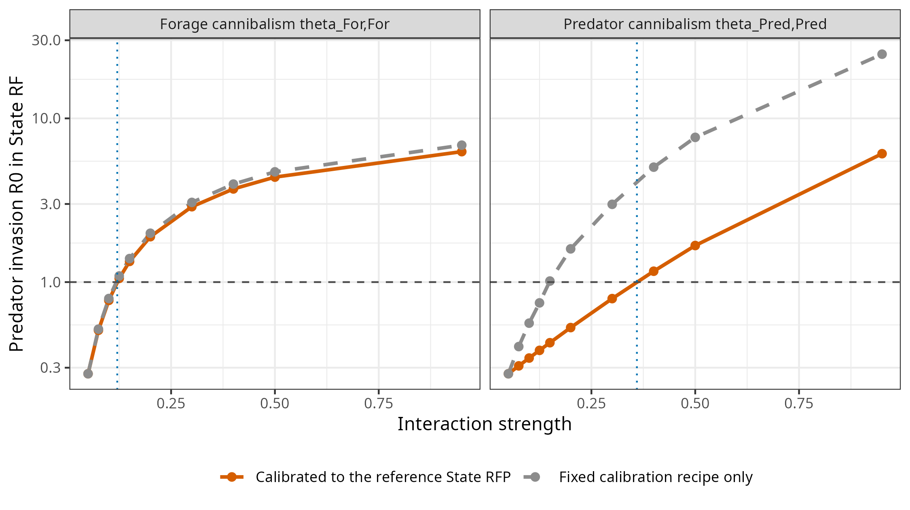

```{r setup, include=FALSE}
knitr::opts_chunk$set(
  echo = FALSE,
  message = FALSE,
  warning = FALSE,
  fig.align = "center",
  out.width = "100%"
)
```

# Introduction

A long-standing puzzle in fisheries ecology is the slow or absent recovery of several piscivorous stocks after fishing was curtailed, most prominently Northwest Atlantic cod (*Gadus morhua*) [@swain2000pelagic; @walters2001cultivation; @frank2005trophic]. Single-species stock--recruitment theory with compensatory density dependence [@beverton1957dynamics] predicts that a depleted stock rebounds once fishing mortality is reduced. In several collapsed ecosystems, however, the decline of large demersal predators was accompanied by increases in small pelagic forage fishes, and the forage fishes were suspected of holding the predators down through predation on their eggs and larvae and through competition with their juveniles [@swain2000pelagic; @frank2005trophic; @swain2012forage].

@walters2001cultivation formalised this as the *cultivation--depensation* hypothesis. Abundant adult piscivores "cultivate" a favourable nursery environment by cropping down forage species; when fishing removes the adults, the forage species are released and suppress juvenile survival of the predator, producing an emergent Allee effect (depensation) at the population level. The empirical evidence is mixed. Across the North Atlantic, the abundance of small pelagics is negatively associated with cod recruitment in some stocks but not others [@minto2012interactions], and on the eastern Scotian Shelf a forage-fish outbreak was later followed by a collapse of the forage fish and the first signs of cod recovery [@frank2011transient], showing that a predator-depleted state need not be permanent. Predator--prey role reversal of this kind is also known from benthic systems [@barkai1988predator] and has been proposed as a mechanism of hysteresis in the North Sea [@fauchald2010predator].

Size-structured population theory has identified several distinct routes to such alternative stable states. In stage-structured consumer--resource models, predators that feed on one life stage of their prey can generate bistability and an emergent Allee effect through food-dependent development of the prey [@deroos2002size; @vankooten2005bistability; @deroos2013population], a mechanism that is different from cultivation--depensation but produces similar population-level signatures [@gardmark2015regime; @vanleeuwen2008cod]. When predator and prey each eat the other's young, the system is a form of life-history intraguild predation, whose coexistence and assembly properties depend strongly on which species is the better competitor for the shared resource [@holt1997theoretical; @hin2011coexistence]. The management implication that a predator can be restored by culling its competitors and predators of its young has been demonstrated experimentally in a whole lake [@persson2007culling] and explored in models of marine reserves [@baskett2006predation].

Multispecies size-spectrum models [@andersen2006asymptotic; @hartvig2011food; @andersen2019fish] describe every fish species from egg to adult, with feeding governed by a size-based prey preference rather than by species identity. Both a 20 g forage fish and a 2 kg piscivore start life at roughly a milligram, so a predator larva necessarily passes through the size window in which adult forage fish feed, and only later grows large enough to eat them. Size-spectrum models have been used to study coexistence of size-structured species [@hartvig2013coexistence], the community effects of rebuilding plans [@andersen2010direct] and balanced exploitation [@law2012balanced; @jacobsen2014consequences; @law2016balanced]. Here we ask whether the standard size-spectrum dynamics implemented in `mizer` [@scott2014mizer] produce cultivation--depensation, and if so, under which conditions. We

1. derive the discrete invasion reproduction numbers of each species at the boundary equilibria and use them to establish the assembly sequence and the priority effect;
2. decompose the predator's invasion failure into larval predation and food effects;
3. compute the fold and invasion boundaries in the plane of predator and forage-fish fishing mortality, including the intermediate states they imply; and
4. test the result against numerical resolution, the strength of size diffusion, the size range of the resource and the strength of intraspecific predation.

# Model Formulation and Methods

## Dynamic Size-Spectrum Framework

We use the multispecies size-spectrum framework of @hartvig2011food and @andersen2019fish as implemented in `mizer` [@scott2014mizer] (version `r res$mizer_version`). The community consists of a plankton resource spectrum $N_R(w, t)$ and two fish size spectra $N_i(w, t)$, $i \in \{\text{Forage}, \text{Predator}\}$, where $N_i(w, t)\,dw$ is the number of individuals with body mass in $[w, w + dw]$ per unit volume. All biomasses below are in grams per this (arbitrary) unit volume, which is fixed by the choice of $\kappa$.

### Resource Dynamics

The resource spans body masses from $`r pow10(res$resource$min_w_pp)`$ g to $`r res$resource$max_w_pp`$ g and follows semichemostat dynamics in each size class:
\begin{equation}
  \frac{\partial N_R(w, t)}{\partial t} = r_R(w)\,\Big[c_R(w) - N_R(w, t)\Big] - \mu_{p,R}(w, t)\,N_R(w, t),
  (\#eq:resource)
\end{equation}
with regeneration rate $r_R(w) = r_0\,w^{n - 1}$ ($r_0 = `r res$resource$r_pp`$ g$^{1-n}$ year$^{-1}$, $n = 2/3$) and predation mortality $\mu_{p,R}$ imposed by the fish. The resource spectrum at State RFP is a power law that tapers off smoothly above $w_R$,
\begin{equation}
  N_R^{\text{RFP}}(w) = \frac{\kappa\,w^{-\lambda}}{1 + (w / w_R)^{`r res$resource$taper`}},
  (\#eq:taper)
\end{equation}
with $\kappa = `r res$resource$kappa`$, $\lambda = 2 + q - n = `r fmt(res$resource$lambda)`$ and $w_R = `r res$resource$w_taper`$ g. During calibration (Section \@ref(community-parameterization)) `mizer` sets the capacity to $c_R = N_R^{\text{RFP}}\,(1 + \mu_{p,R}/r_R)$ so that this spectrum is a steady state. The capacity therefore coincides with $N_R^{\text{RFP}}$ at small sizes but exceeds it by up to a factor `r fmt(res$resource$capacity_ratio_max, 1)` at $w \approx `r sig(res$resource$w_at_capacity_ratio_max, 2)`$ g, where the fish graze the resource most heavily. A smooth taper rather than a sharp upper cutoff keeps the prey spectrum smooth, which the second-order discretisation requires (Section \@ref(community-parameterization)).

### Fish Growth, Mortality, and Reproduction

The abundance density of each fish species satisfies the McKendrick--von Foerster equation with size diffusion,
\begin{equation}
  \frac{\partial N_i}{\partial t} + \frac{\partial \big(g_i\,N_i\big)}{\partial w} - \frac{1}{2}\frac{\partial^2 \big(D_i\,N_i\big)}{\partial w^2} = -\mu_i\,N_i,
  (\#eq:mvf)
\end{equation}
on the size range $[w_{\min,i}, w_{\max,i}]$, with growth rate $g_i(w, t)$, size diffusion rate $D_i(w)$ and mortality rate $\mu_i(w, t)$ specified below. Predators of mass $w$ prefer prey of mass $w'$ according to the lognormal kernel
\begin{equation}
  \phi_i(w / w') = \exp\!\left[-\frac{\big(\ln(w / (w'\,\beta_i))\big)^2}{2\,\sigma_i^2}\right],
  (\#eq:kernel)
\end{equation}
with preferred predator--prey mass ratio $\beta_i$ and width $\sigma_i$. The kernel expresses a size preference, not a strict gape limit. The available prey biomass combines resource and fish weighted by the interaction matrix $\theta_{ij}$ (predator $i$, prey $j$):
\begin{equation}
  E_{a,i}(w, t) = \int \phi_i(w / w')\,\left[N_R(w', t) + \sum_{j} \theta_{ij}\,N_j(w', t)\right] w'\,dw'.
  (\#eq:encounter)
\end{equation}
With search volume $\gamma_i\,w^q$ and maximum intake rate $h_i\,w^n$ the feeding level is
\begin{equation}
  f_i(w, t) = \frac{\gamma_i\,w^q\,E_{a,i}(w, t)}{\gamma_i\,w^q\,E_{a,i}(w, t) + h_i\,w^n}.
  (\#eq:feeding)
\end{equation}
Assimilated energy (efficiency $\alpha = 0.6$) minus metabolic costs $k_{s,i}\,w^p$ is split between reproduction and growth:
\begin{align}
  E_{r,i}(w, t) &= \max\!\Big(0,\; \alpha\,f_i(w, t)\,h_i\,w^n - k_{s,i}\,w^p\Big), (\#eq:er) \\
  g_i(w, t) &= E_{r,i}(w, t)\,\big[1 - \psi_i(w)\big]. (\#eq:growth)
\end{align}
The investment function $\psi_i(w) = m_i(w)\,(w / w_{\infty,i})^{1-n}$ is the product of the maturity ogive $m_i(w) = [1 + (w/w_{\text{mat},i})^{-U_i}]^{-1}$ and an allometric factor that reaches one at $w_{\infty,i}$, so that growth stops at $w_{\infty,i}$. We set the steepness $U_i = \ln 3 / \ln(w_{\text{mat},i}/w_{\text{mat25},i})$ by placing 25% maturity at 90% of the length at 50% maturity, $w_{\text{mat25},i} = 0.9^3\,w_{\text{mat},i}$, which gives $U \approx 3.5$ and a 25--75% maturation range of about 20% of the length at maturation. `mizer`'s default, $U = 10$, corresponds to a range of only 7%, steeper than typical empirical maturity ogives, and switches from immature to mature within two or three size classes of a 160-class grid.

The diffusion rate $D_i(w)$ in Eq. \@ref(eq:mvf) represents the variability of growth among individuals of the same size, which arises from the randomness of prey encounters [the jump-growth term of @datta2010jump] and, more importantly, from individual differences in foraging success, condition, physiology and environment. Without it, all individuals of a cohort would grow along the same trajectory. Under Eq. \@ref(eq:mvf) the variance of body mass within a cohort grows at rate $D_i$, so the variance $\sigma^2$ of $\ln w$ increases by
\begin{equation}
  \frac{d\sigma^2}{d \ln w} = \frac{D_i(w)}{g_i(w)\,w} \equiv c
  (\#eq:cdiff)
\end{equation}
per unit of $\ln w$ that the cohort grows. Juveniles ($\psi_i \approx 0$) feeding at the reference feeding level $f_0$ (Section \@ref(community-parameterization)) grow at approximately $g_i(w) \approx (\alpha f_0 h_i - k_{s,i})\,w^n$ by Eqs. \@ref(eq:er) and \@ref(eq:growth). We therefore take $D_i(w) = D_{\text{ext},i}\,w^{n+1}$ and choose $D_{\text{ext},i} = c\,(\alpha f_0 h_i - k_{s,i})$, so that $c$ is approximately constant over the juvenile size range. In the reference model $c = `r fmt(res$c_diff, 2)`$: a cohort that grows from egg ($10^{-3}$ g) to the predator's maturation size spans $\ln(250/10^{-3}) \approx 12.4$ units of $\ln w$ and acquires a standard deviation of $\ln w$ of about `r fmt(sqrt(12.4 * res$c_diff), 1)`, i.e. adults of the same age differ in mass by a typical factor of `r fmt(exp(sqrt(12.4 * res$c_diff)), 1)`. Because this level is uncertain, we report all thresholds for $c$ between 0.02 and 0.3 (Section \@ref(robustness)). Mean growth stops at $w_{\infty,i}$, but size diffusion carries some individuals beyond it; a senescence mortality (below) keeps them from spreading further.

Total mortality $\mu_i(w, t) = \mu_{p,i}(w, t) + \mu_{\text{ext},i}(w) + F_i\,S_i(w)$ comprises:

1. **Predation mortality** imposed by all fish species $j$:
   \begin{equation}
     \mu_{p,i}(w', t) = \sum_{j} \theta_{ji} \int \phi_j(w / w')\,\big[1 - f_j(w, t)\big]\,\gamma_j\,w^q\,N_j(w, t)\,dw;
     (\#eq:predmort)
   \end{equation}
2. **External mortality** $\mu_{\text{ext},i}(w) = z_{0,i} + z_{\text{ext},i}\,w^{\,n-1} + z_{\text{sen}}\,(w / w_{\infty,i})^{k}$ with $w$ in grams. Because $n - 1 = -1/3$, the second term represents mortality from unmodelled predators of small fish; it is largest for larvae (`r fmt(res$ext_mort_wmin["Forage"], 1)` and `r fmt(res$ext_mort_wmin["Predator"], 1)` year$^{-1}$ at $w_{\min}$ for forage fish and predator) and small for adults. The third term ($z_{\text{sen}} = `r res$senescence$z_sen`$ year$^{-1}$, $k = `r res$senescence$k_sen`$) is a senescence mortality that is negligible below $0.8\,w_{\infty,i}$ and rises steeply above $w_{\infty,i}$. It is needed because size diffusion continues where mean growth stops: without it, adults would random-walk to several times $w_{\infty,i}$, where only the small background mortality removes them, and the results would depend on where the size grid ends. With it, `r fmt(100 * res$biomass_above_w_inf["Predator"], 0)`% of predator biomass at State RFP lies above $w_{\infty}$, and the grid, which ends at $w_{\max,i} = `r res$senescence$w_max_factor`\,w_{\infty,i}$, holds a negligible density at its upper end;
3. **Fishing mortality** $F_i\,S_i(w)$ with logistic length-based selectivity
   \begin{equation}
     S_i(w) = \left[1 + \exp\!\left(\ln 3\,\frac{l_{50,i} - l(w)}{l_{50,i} - l_{25,i}}\right)\right]^{-1}, \qquad l(w) = (w/a)^{1/b},
     (\#eq:selectivity)
   \end{equation}
   where $l_{50,i}$ and $l_{25,i}$ are the lengths at 50% and 25% selection and $w = a\,l^b$ with $a = 0.01$ g cm$^{-3}$ and $b = 3$. $F_i$ is thus the fishing mortality on fully selected fish.

The density-independent egg production rate is
\begin{equation}
  R_{\text{DI},i}(t) = \frac{1}{2}\,\frac{\epsilon_i}{w_{\min,i}} \int_{w_{\min,i}}^{w_{\max,i}} E_{r,i}(w, t)\,\psi_i(w)\,N_i(w, t)\,dw,
  (\#eq:rdi)
\end{equation}
where the reproductive efficiency $\epsilon_i$ (`erepro` in `mizer`) also absorbs egg and early larval losses not otherwise modelled. Recruitment follows a Beverton--Holt relationship [@beverton1957dynamics]
\begin{equation}
  R_{\text{DD},i}(t) = \frac{R_{\text{DI},i}(t)}{1 + R_{\text{DI},i}(t) / R_{\max,i}},
  (\#eq:rdd)
\end{equation}
which sets the flux $g_i N_i$ at $w_{\min,i}$. We parameterise the compensation by the reproduction level $L_{R,i} = R_{\text{DD},i}^* / R_{\max,i}$ at State RFP.

## Community Parameterization

Table \@ref(tab:params-table) lists the parameters of the model as used in the simulations (`build_cultivation_model()` in `cultivation_depensation.R`). Both species recruit at $w_{\min} = 10^{-3}$ g. Adult forage fish ($w \in [4, 20]$ g, $\beta = 200$) feed preferentially on prey of 0.02--0.1 g, the larval and early juvenile sizes of the predator. Maturing and adult predators ($w \in [250, 2000]$ g, $\beta = 100$) prefer prey of 2.5--20 g, the juvenile and adult forage fish, but also take the larger resource classes around $w_R = `r res$resource$w_taper`$ g. Maximum intake rates $h_i$ follow from the von Bertalanffy growth rates, search volumes $\gamma_i$ from the reference feeding level $f_0 = 0.6$, and metabolic coefficients $k_{s,i}$ from `mizer`'s default critical feeding level of 0.2 [@andersen2019fish].

The interaction matrix is
\begin{equation}
  \boldsymbol{\theta} = \begin{pmatrix} \theta_{\text{For,For}} & \theta_{\text{For,Pred}} \\ \theta_{\text{Pred,For}} & \theta_{\text{Pred,Pred}} \end{pmatrix} = \begin{pmatrix} 0.05 & 0.95 \\ 1.00 & 0.05 \end{pmatrix}.
  (\#eq:inter)
\end{equation}
This matrix is strongly asymmetric. Adult forage fish encounter predator larvae at almost full rate ($\theta_{\text{For,Pred}} = 0.95$) but their own larvae, which have exactly the same size, at only 5% of that rate. Biologically this corresponds to spatial or temporal separation of forage-fish spawning from forage-fish feeding grounds, combined with overlap between forage-fish adults and predator spawning and nursery areas, as proposed for pelagic fishes feeding on cod eggs and larvae [@swain2000pelagic; @fauchald2010predator]. Predator cannibalism is likewise weak ($\theta_{\text{Pred,Pred}} = 0.05$). Section \@ref(robustness) shows that both choices are essential for the results.

The model was calibrated to the target biomasses $B_{\text{Forage}} = 100$ g and $B_{\text{Predator}} = 600$ g at State RFP (`matchBiomasses()` and `tuneSteadyState()`), which determines $\epsilon_i$ and the resource capacity. These targets are illustrative, not observations. The reproduction levels were then set to $L_R = 0.65$ (forage) and $0.78$ (predator), which fixes $R_{\max,i}$ while preserving the steady state, and the fixed point was solved for with `mizer`'s Newton solver. Two separate gears with unit catchability, so that effort equals the fishing mortality on fully selected fish, act on forage fish with 50% selection at 1 g ($l_{50} = `r fmt(sp("l50", "Forage"), 1)`$ cm; juveniles and adults, since maturation is at 4 g) with mortality $F_{\text{Forage}}$, and on predators with 50% selection at 400 g ($l_{50} = `r fmt(sp("l50", "Predator"), 1)`$ cm) with mortality $F_{\text{Pred}}$. For both gears $l_{25} = 0.9\,l_{50}$, a selection range ($l_{75} - l_{25}$) of 20% of $l_{50}$, typical of trawl gear; the selectivity rises from 25% to 75% over about 0.6 units of $\ln w$, i.e. over many size classes. A knife-edge selectivity would introduce a discontinuity that limits the numerical accuracy to first order. The size axis is discretised into `r res$grid$no_w` logarithmically spaced classes ($\Delta \ln w = `r fmt(res$grid$dx, 3)`$). We use `mizer`'s second-order finite-volume scheme (`second_order_w`), with a centred advective flux and bin-averaged rates, so that the numerical diffusion is small compared with the physical diffusion. This matters: `mizer`'s default first-order upwind scheme adds numerical diffusion equivalent to $c \approx \Delta \ln w$, which on a grid of 80 classes ($c \approx 0.19$) exceeds the physical diffusion assumed here and has the wrong dependence on the grid (Section \@ref(robustness)). The resource grid extends down to $10^{-9}$ g, so that the feeding kernels of newly hatched larvae, which prefer prey of $5 \times 10^{-6}$ g (forage fish) and $10^{-5}$ g (predator), lie on the grid to more than six standard deviations below their peak. Time-dependent simulations use the second-order TR-BDF2 method with $\Delta t = 0.1$ year; steady states are solved for with `mizer`'s Newton solver.

```{r params-table}
spt <- res$species_params
row <- function(label, col, digits = NULL, f = identity) {
  v <- f(spt[[col]])
  v <- if (is.null(digits)) as.character(v) else vapply(v, function(x) format(signif(x, digits)), "")
  c(label, v)
}
param_df <- as.data.frame(rbind(
  row("Asymptotic mass $w_\\infty$ [g]", "w_inf"),
  row("Largest size class $w_{\\max}$ [g]", "w_max"),
  row("Maturation mass $w_{\\text{mat}}$ [g]", "w_mat"),
  row("Mass at which a quarter are mature, $w_{\\text{mat25}}$ [g]", "w_mat25", 3),
  row("Egg mass $w_{\\min}$ [g]", "w_min"),
  row("Preferred predator--prey mass ratio $\\beta$", "beta"),
  row("Feeding kernel width $\\sigma$", "sigma"),
  row("von Bertalanffy growth rate $k_{\\text{vb}}$ [year$^{-1}$]", "k_vb"),
  row("Reference feeding level $f_0$", "f0"),
  row("Search volume coefficient $\\gamma$", "gamma", 3),
  row("Maximum intake coefficient $h$ [g$^{1-n}$ year$^{-1}$]", "h", 3),
  row("Metabolic coefficient $k_s$ [g$^{1-p}$ year$^{-1}$]", "ks", 3),
  row("Exponents $n$, $p$, $q$", "n", f = function(x) sprintf("%.3f, %.2f, %.3f", x, spt$p, spt$q)),
  row("Assimilation efficiency $\\alpha$", "alpha"),
  row("External mortality $z_0$ [year$^{-1}$]", "z0"),
  row("External mortality $z_{\\text{ext}}$ [g$^{1/3}$ year$^{-1}$]", "z_ext"),
  row("Reproductive efficiency $\\epsilon$ (calibrated)", "erepro", 3),
  row("Maximum recruitment $R_{\\max}$ (calibrated)", "R_max", 3),
  row("Reproduction level $L_R$ at State RFP", "reproduction_level", 3),
  row("Size diffusion coefficient $D_{\\text{ext}}$ [g$^{1/3}$ year$^{-1}$]", "D_ext", 3),
  row("Length at which half the fish are selected, $l_{50}$ [cm]", "l50", 3),
  row("Length at which a quarter are selected, $l_{25}$ [cm]", "l25", 3)
))
names(param_df) <- c("Parameter", spt$species)
knitr::kable(
  param_df,
  booktabs = TRUE,
  escape = FALSE,
  caption = sprintf("Parameters of the two fish species as used in the simulations. Resource: $\\kappa = %s$, $\\lambda = %s$, $r_0 = %s$ g$^{1/3}$ year$^{-1}$, size range $%s$--$%s$ g, taper at $w_R = %s$ g. Interaction matrix in Eq. \\@ref(eq:inter).",
                    res$resource$kappa, fmt(res$resource$lambda), res$resource$r_pp,
                    pow10(res$resource$min_w_pp), res$resource$max_w_pp, res$resource$w_taper)
)
```

## Steady States, Stability, and Invasion Reproduction Numbers

We name each equilibrium by the components it contains: R for the plankton resource, F for the forage fish and P for the predator. Starting from the calibrated coexistence equilibrium (**State RFP**) we obtain the boundary equilibria with *identical* parameters (`get_fixed_points()`): **State RP** (resource + predator) by removing the forage fish, projecting and solving for the fixed point, **State RF** (resource + forage fish) by removing the predator, and **State R** (resource only) with both fish absent and $N_R = c_R$. Over a subsequent 100-year projection no biomass changes by more than a fraction $`r sci(max(res$states$drift), 1)`$ per year.

*Invasion reproduction number.* For a species $i$ absent from a resident equilibrium, the resident environment fixes its growth rate $g_i(w)$, diffusion $D_i(w)$, mortality $\mu_i(w)$ and reproductive investment. We solve the linear steady-state transport equation of the discretised model for a unit density in the first size class, compute the resulting lifetime egg production $R_{\text{DI},i}^{(1)}$ with Eq. \@ref(eq:rdi), and divide by the recruitment flux $R_{\text{req},i}$ needed to sustain that density, which we read from the balance of the first size class in the same discretisation:
\begin{equation}
  R_{0,i} = \frac{R_{\text{DI},i}^{(1)}}{R_{\text{req},i}}.
  (\#eq:r0)
\end{equation}
Because the Beverton--Holt function has unit slope at zero, a rare species increases if and only if $R_{0,i} > 1$ [@diekmann1990definition]; we confirm this below against the leading eigenvalue. For a resident species the same quantity equals $R_{\text{DI}}^*/R_{\text{DD}}^* = 1/(1 - L_R) > 1$; it measures the compensatory reserve of recruitment rather than invasion. We use this identity as a check of the calculation, which it passes to four significant figures. Section \@ref(robustness) reports how $R_0$ changes with the number of size classes.

*Linear stability.* We compute the eigenvalues of the Jacobian of the discretised fish--resource system with `getStability()`. `getStability()` linearises only over species that are present; to obtain the stability of a boundary equilibrium in the full system, we add the absent species at a trace density ($10^{-12}$ of its State RFP abundance), which adds its invasion exponent to the spectrum. We confirm the invasion exponent against the decay of a predator seed in direct simulation.

*Unstable interior equilibrium.* The saddle that separates the basins of attraction of States RFP and RF is located by edge tracking: we bisect on the size of a predator seed added to State RF to find the basin boundary, follow a trajectory started on it to where it lingers, and refine that state with `mizer`'s Newton solver.

*Bifurcation boundaries.* For each forage-fish mortality $F_{\text{Forage}} \in \{0, 0.025, \ldots, 0.7\}$ year$^{-1}$ we compute (i) the predator invasion boundary $F_{\text{inv}}$, where $R_{0,\text{Pred}}(\text{State RF}) = 1$; (ii) the upper limit $F_{\text{up}}$ of the abundant coexistence state, by continuation from State RFP in steps of 0.01 followed by bisection to 0.001, classifying a state as abundant when the predator biomass exceeds `r 100` g; and (iii) the lower limit $F_{\text{low}}$ of the depleted state, by continuation downward from State RF with a predator seed. Each step is projected (with the first-order time step, $\Delta t = 0.5$ year, which leaves the fixed points unchanged) until every biomass changes by less than $10^{-5}$ per year; this strict criterion is needed because trajectories linger near a fold. Finally, we determine by bisection the smallest forage-fish mortality $F_{\text{Forage,rec}}$ at which a predator reintroduced into State RF (at 0.5% of its State RFP abundance, with $F_{\text{Pred}} = 0$) returns to the abundant state. A leading eigenvalue that tends to zero as $F_{\text{Pred}} \to F_{\text{up}}$ identifies $F_{\text{up}}$ as a fold (saddle-node) bifurcation. Where $F_{\text{low}} < F_{\text{inv}}$, the depleted state below $F_{\text{inv}}$ contains a small predator population, so the invasion bifurcation is supercritical.

*Robustness.* We rebuild and recalibrate the model with half and twice as many size classes; with the first-order upwind scheme, 80 size classes and no physical diffusion (the discretisation of the first version of this study); with the resource taper at $w_R = 1$ g instead of 10 g; for size diffusion $c$ from 0.02 to 0.3; and over a range of forage-fish and predator cannibalism ($\theta_{\text{For,For}}$ and $\theta_{\text{Pred,Pred}}$ from 0.05 to 0.95, one at a time). For $c < \Delta \ln w$ the centred flux is no longer monotone and we use the van Leer limiter instead.

# Results

## Unfished Alternative Stable States and the Depensatory Bottleneck

Without fishing the model has the four boundary and interior equilibria listed in Table \@ref(tab:states-table) and, in addition, an unstable interior saddle. States RFP and RF are locally asymptotically stable in the full system. State RP is stable within the resource--predator subspace but is a saddle in the full system, because forage fish invade it. State R is invaded by both fish species.

```{r states-table}
s <- res$states
states_df <- data.frame(
  Composition = c("Resource only", "Resource + Forage + Predator", "Resource + Predator", "Resource + Forage"),
  B_For = fmt(s$Forage_Biomass, 1),
  B_Pred = fmt(s$Predator_Biomass, 1),
  R0_For = fmt(s$R0_Forage),
  R0_Pred = fmt(s$R0_Predator),
  lam_res = fmt(s$lambda_resident, 3),
  lam_full = fmt(s$lambda_full, 3),
  Stable = ifelse(s$lambda_full < 0, "Yes", "No")
)
colnames(states_df) <- c(
  "Resident taxa", "$B_{\\text{For}}^*$ [g]", "$B_{\\text{Pred}}^*$ [g]",
  "$R_{0,\\text{For}}$", "$R_{0,\\text{Pred}}$", "$\\lambda_{\\text{res}}$", "$\\lambda_{\\text{full}}$", "Stable"
)
knitr::kable(
  states_df,
  booktabs = TRUE,
  escape = FALSE,
  align = "lrrrrrrc",
  caption = "The four boundary and interior equilibria without fishing. $R_0$ of an absent species is its invasion reproduction number; for a resident species it equals $1/(1 - L_R)$. $\\lambda_{\\text{res}}$ is the leading eigenvalue [year$^{-1}$] within the resident subspace (for State R, the slowest resource relaxation rate), $\\lambda_{\\text{full}}$ the leading eigenvalue including the invasion exponents of absent species. Eigenvalues of unreachable size classes are excluded. Stable: $\\lambda_{\\text{full}} < 0$."
)
```

The saddle lies at $B_{\text{Forage}} = `r fmt(res$saddle$biomass["Forage"], 0)`$ g and $B_{\text{Predator}} = `r fmt(res$saddle$biomass["Predator"], 0)`$ g and has a single unstable eigenvalue (`r fmt(res$saddle$leading, 3)` year$^{-1}$). The predator invasion exponent at State RF, $\lambda_{\text{full}} = `r fmt(state("State_RF")$lambda_full, 3)`$ year$^{-1}$, agrees with the decay rate of a predator seed in direct simulation (`r fmt(res$invasion_RF_decay_rate, 3)` year$^{-1}$; Figure \@ref(fig:fig-invasions)B), and the forage-fish invasion exponent at State RP is `r fmt(state("State_RP")$lambda_full, 2)` year$^{-1}$, confirming the $R_0$ criteria.

Comparing States RFP and RF exposes the mechanism (Figure \@ref(fig:fig-spectra)). In State RFP the predator ($B^*_{\text{Pred}} = `r fmt(state("State_RFP")$Predator_Biomass, 1)`$ g) holds forage-fish biomass down to `r fmt(state("State_RFP")$Forage_Biomass, 1)` g, and predation mortality on predator larvae ($w \le 1$ g) is at most `r fmt(res$larval_predmort$max_RFP, 1)` year$^{-1}$. Without the predator, forage-fish biomass rises `r fmt(state("State_RF")$Forage_Biomass / state("State_RFP")$Forage_Biomass, 0)`-fold to `r fmt(state("State_RF")$Forage_Biomass, 0)` g, grazes a trough into the resource around 0.01--0.5 g and raises predation mortality on predator larvae to a peak of `r fmt(res$larval_predmort$max_RF, 1)` year$^{-1}$ at $w \approx `r fmt(res$larval_predmort$w_at_max_RF, 2)`$ g. Survival of a predator from egg to maturation falls from `r sig(res$survival_to_maturity["RFP"], 2)` in State RFP to `r sig(res$survival_to_maturity["RF"], 2)` in State RF, a factor of `r fmt(res$survival_to_maturity["RFP"] / res$survival_to_maturity["RF"], 0)`.

The forage fish affect the predator in two ways: they eat its larvae, and they compete with its larvae for the resource while providing food for its adults. To separate the two, we compute $R_{0,\text{Pred}}$ with growth and reproduction from one state and mortality from the other. With State RFP growth and State RF mortality, $R_{0,\text{Pred}} = `r fmt(res$R0_decomposition["growthRFP_mortRF"])`$; with State RF growth and State RFP mortality, $R_{0,\text{Pred}} = `r fmt(res$R0_decomposition["growthRF_mortRFP"], 1)`$. The invasion barrier is therefore caused entirely by larval predation. The food effect acts in the opposite direction: in State RF, adult predators would find abundant forage fish and grow and reproduce faster than in State RFP.

Even in State RFP, adult predators take only `r fmt(100 * res$predator_diet_RFP["Forage"], 0)`% of their food from forage fish and `r fmt(100 * res$predator_diet_RFP["Resource"], 0)`% from the resource, which extends beyond 10 g. In this model the "predator" is a generalist whose population does not depend on the forage fish for food, which is also why it persists in State RP.

```{r fig-spectra, fig.cap="Unfished equilibrium size spectra and the depensatory bottleneck. Top left: coexistence State RFP. Top right: resource--predator State RP. Bottom left: resource--forage State RF, where release from predation allows the forage fish to expand and graze down the resource. Bottom right: predation mortality on predator early life stages ($w \\le 10$ g) in State RFP (solid green) and State RF (dashed magenta)."}

```

## Priority Effects and Sequential Community Assembly

The invasion reproduction numbers define the assembly sequence from the resource-only State R:

1. Both fish species can invade State R ($R_{0,\text{For}} = `r fmt(state("State_R")$R0_Forage, 0)`$, $R_{0,\text{Pred}} = `r fmt(state("State_R")$R0_Predator, 1)`$).
2. If the predator establishes first (State R $\to$ RP), forage fish can invade ($R_{0,\text{For}} = `r fmt(state("State_RP")$R0_Forage)`$). A forage seed of $10^{-3}$ of its State RFP abundance grows and the community converges to State RFP (Figure \@ref(fig:fig-invasions)A), with predator biomass increasing from `r fmt(state("State_RP")$Predator_Biomass, 1)` to `r fmt(res$invasion_RP_final["Predator"], 1)` g.
3. If the forage fish establishes first (State R $\to$ RF), the predator cannot invade ($R_{0,\text{Pred}} = `r fmt(state("State_RF")$R0_Predator)`$). A predator seed of $10^{-2}$ of its State RFP abundance briefly increases as the seeded adults spawn, then declines exponentially at a rate of `r fmt(-res$invasion_RF_decay_rate, 3)` year$^{-1}$ (Figure \@ref(fig:fig-invasions)B).

Without fishing the system is therefore bistable between States RFP and RF, and assembly of the full food web from rare invaders requires the predator to arrive first. Because the forage fish has the much larger invasion number in State R, simultaneous arrival of rare colonists of both species would favour State RF. Priority effects of this kind are expected in life-history intraguild predation, where each species preys on the other's young [@holt1997theoretical; @hin2011coexistence].

```{r fig-invasions, fig.cap="Invasion experiments without fishing. (A) A trace population of forage fish introduced into the resource--predator State RP invades and the community converges to State RFP. (B) A seed population of predators introduced into the resource--forage State RF declines exponentially, because predation by forage fish on predator larvae keeps $R_{0,\\text{Pred}} < 1$."}

```

## Selective Predator Exploitation and Catastrophic Collapse

```{r}
b0 <- bound(0); b35 <- bound(0.35)
bd_fold <- res$bounds[res$bounds$F_Forage < res$cusp_F_Forage, ]
br <- res$branches
up0 <- br[br$F_Forage == 0 & grepl("Increasing", br$Sweep), ]
```

When only the predator is fished, increasing $F_{\text{Pred}}$ gradually lowers predator biomass and releases the forage fish (Figure \@ref(fig:fig-bifurcation), left), until the abundant coexistence state disappears at $F_{\text{crit}} = `r fmt(res$F_crit, 3)`$ year$^{-1}$. Just below this threshold the predator biomass is still `r fmt(b0$B_up, 0)` g, and the leading eigenvalue is within `r fmt(max(abs(bd_fold$lead_up)), 3)` year$^{-1}$ of zero, as it is at every point of the upper boundary below the cusp (Section \@ref(two-parameter-exploitation-diagram)): State RFP is lost at a fold bifurcation, where it merges with the saddle. Above $F_{\text{crit}}$ the community jumps to State RF. Because State RF is uninvasible for every $F_{\text{Pred}} \ge 0$ when $F_{\text{Forage}} = 0$, reducing $F_{\text{Pred}}$ again does not bring the predator back: the decreasing sweep stays in State RF down to $F_{\text{Pred}} = 0$.

Harvesting the forage fish at $F_{\text{Forage}} = 0.35$ year$^{-1}$ (Figure \@ref(fig:fig-bifurcation), right) raises the collapse threshold to $F_{\text{up}} = `r fmt(b35$F_up, 3)`$ year$^{-1}$, again a fold (predator biomass `r fmt(b35$B_up, 0)` g just below it). The state it collapses to is different. At this forage harvest the predator can invade State RF for $F_{\text{Pred}} < F_{\text{inv}} = `r fmt(b35$F_inv, 3)`$ year$^{-1}$, and the invasion leads to a low-abundance coexistence state rather than to State RFP. `r if (b35$RFP_low) sprintf("When fishing pressure is reduced again, this low-predator state persists down to $F_{\\text{Pred}} = %s$ year$^{-1}$ before the predator recovers to the abundant state, so the hysteresis loop spans %s--%s year$^{-1}$.", fmt(b35$F_low, 3), fmt(b35$F_low, 3), fmt(b35$F_up, 3)) else ""`

```{r fig-bifurcation, fig.cap="Equilibrium biomass of forage fish (blue) and predator (orange) along increasing (solid, starting from State RFP) and decreasing (dashed, starting from State RF with a predator seed) predator fishing mortality, without forage-fish harvesting (left) and with $F_{\\text{Forage}} = 0.35$ year$^{-1}$ (right). Thin arrows mark where a branch of stable states ends and the system jumps to another. The vertical scale is pseudo-logarithmic so that both zero and small predator biomasses are visible. Where the two sweeps differ, the system is bistable."}

```

## Hysteresis Under Moratorium and Recovery via Forage-Fish Harvesting

```{r}
h <- res$hysteresis
```

Figure \@ref(fig:fig-hysteresis) follows a five-phase management scenario:

1. **Years 0--50, unfished**: the community is at State RFP.
2. **Years 50--200, predator overfishing** ($F_{\text{Pred}} = `r h$f_over`$ year$^{-1}$, above $F_{\text{crit}}$; $F_{\text{Forage}} = 0$): the predator collapses and forage fish rise to `r fmt(h$end_phase2["Forage"], 0)` g.
3. **Years 200--320, moratorium**: all fishing stops and predators are reintroduced at 0.5% of their State RFP abundance. Because $R_{0,\text{Pred}}(\text{State RF}) = `r fmt(state("State_RF")$R0_Predator)`$, the reintroduced population declines.
4. **Years 320--470, forage-fish harvest**: forage fish are fished at $F_{\text{Forage}} = `r fmt(h$f_forage_restore)`$ year$^{-1}$ and predators are reintroduced again. This is above $F_{\text{Forage,rec}} = `r fmt(res$F_forage_rec, 3)`$ year$^{-1}$ (Section \@ref(two-parameter-exploitation-diagram)). Forage-fish biomass in State RF falls to `r fmt(BRF(h$f_forage_restore), 0)` g and $R_{0,\text{Pred}}$ rises to `r fmt(r0RF(h$f_forage_restore))`. The predator invades, exceeds half its State RFP biomass by year `r fmt(h$year_pred_above_half_RFP, 0)`, and suppresses the forage fish.
5. **Years 470--570, unfished**: when the forage fishery stops, the community remains in State RFP ($B_{\text{Pred}} = `r fmt(h$end_phase5["Predator"], 1)`$ g, $B_{\text{For}} = `r fmt(h$end_phase5["Forage"], 1)`$ g), the state it occupied before overfishing.

The deterministic model can only recover the predator from a reintroduction or immigration, since an extinct population cannot invade; this is why predators are seeded in phases 3 and 4.

```{r fig-hysteresis, fig.cap="Five-phase management scenario. Phase 2: selective predator overfishing collapses the predator. Phase 3: a moratorium with predator reintroduction fails because State RF is uninvasible. Phase 4: harvesting the forage fish makes State RF invasible and the reintroduced predator recovers. Phase 5: after all fishing stops, the restored State RFP persists."}

```

## Two-Parameter Exploitation Diagram

```{r}
bd <- res$bounds
```

In State RF, harvesting the forage fish reduces its biomass and increases $R_{0,\text{Pred}}$ (Figure \@ref(fig:fig-regime)A), from `r fmt(r0RF(0))` at $F_{\text{Forage}} = 0$ to `r fmt(r0RF(max(res$r0_curve$F_Forage)))` at $F_{\text{Forage}} = `r fmt(max(res$r0_curve$F_Forage), 1)`$ year$^{-1}$. The predator can invade State RF once
\begin{equation}
  F_{\text{Forage}} > F_{\text{Forage,inv}} = `r fmt(res$F_forage_inv, 3)`\text{ year}^{-1},
  (\#eq:ff-inv)
\end{equation}
at which State RF holds `r fmt(res$B_forage_RF_at_inv, 0)` g of forage fish.

Figure \@ref(fig:fig-regime)B shows the computed regimes in the $(F_{\text{Forage}}, F_{\text{Pred}})$ plane. The fold that bounds the abundant coexistence state, $F_{\text{up}}$, rises from `r fmt(res$F_crit, 3)` year$^{-1}$ without forage harvest to `r fmt(bound(0.25)$F_up, 3)` at $F_{\text{Forage}} = 0.25$ and `r fmt(b35$F_up, 3)` at $F_{\text{Forage}} = 0.35$ year$^{-1}$. The predator invasion boundary of State RF, $F_{\text{inv}}$, rises more steeply, from zero at $F_{\text{Forage,inv}}$ to `r fmt(b35$F_inv, 3)` year$^{-1}$ at $F_{\text{Forage}} = 0.35$. The two curves cross, but they do not meet at a single codimension-two point as the simplest picture would suggest. Instead the plane divides as follows:

1. **No invasion** ($F_{\text{Forage}} < F_{\text{Forage,inv}}$). State RF is uninvasible for every $F_{\text{Pred}} \ge 0$, so the abundant state and State RF are both stable from $F_{\text{Pred}} = 0$ up to the fold $F_{\text{up}}$ (amber region), and only State RF remains above it. This is why a moratorium on predator fishing alone cannot restore the predator.
2. **Invasion to a low-predator state** ($F_{\text{Forage}} > F_{\text{Forage,inv}}$). Wherever $F_{\text{inv}} > 0$, the invasion bifurcation of State RF is supercritical: a predator invading at $F_{\text{Pred}}$ just below $F_{\text{inv}}$ settles at a low abundance rather than returning to the abundant state. The low-predator state persists down to its own lower limit $F_{\text{low}}$, below which the predator recovers fully. Between $\max(0, F_{\text{low}})$ and $F_{\text{up}}$ the abundant state is bistable with State RF (amber, above $F_{\text{inv}}$) or with the low-predator state (yellow, below $F_{\text{inv}}$), and where $F_{\text{up}} < F_{\text{inv}}$ the low-predator state is the only attractor between them (pink). Because $F_{\text{low}}$ is negative only for $F_{\text{Forage}} > F_{\text{Forage,rec}} = `r fmt(res$F_forage_rec, 3)`$ year$^{-1}$, a predator reintroduced without any predator fishing recovers fully only above this forage harvest; for $`r fmt(res$F_forage_inv, 3)` < F_{\text{Forage}} < `r fmt(res$F_forage_rec, 3)`$ year$^{-1}$ it persists only as a remnant.
3. **Cusp** ($F_{\text{Forage}} \approx `r cusp_range`$ year$^{-1}$). The upper fold of the abundant state and the lower limit of the low-predator state approach each other as forage harvest increases: the width of the bistable interval shrinks from `r fmt(hyst_width(0.35), 3)` year$^{-1}$ at $F_{\text{Forage}} = 0.35$ to `r fmt(hyst_width(0.6), 3)` year$^{-1}$ at $F_{\text{Forage}} = 0.6$ and has closed at `r fmt(res$cusp_F_Forage, 3)` year$^{-1}$. Beyond the cusp the predator declines continuously with increasing $F_{\text{Pred}}$ and recovers along the same path when fishing is reduced.

Forage-fish harvesting therefore removes the regime shift only at forage-fish fishing mortalities above about `r fmt(res$cusp_F_Forage - 0.025, 2)` year$^{-1}$, well beyond the level needed to make State RF invasible.

```{r fig-regime, fig.cap="(A) Predator invasion reproduction number in State RF as a function of forage-fish fishing mortality; State RF becomes invasible above $F_{\\text{Forage,inv}}$. (B) Regimes in the $(F_{\\text{Forage}}, F_{\\text{Pred}})$ plane computed from the upper limit of the abundant coexistence state (solid), the lower limit of the depleted state (dotted) and the predator invasion boundary of State RF (dashed). Beyond the cusp the abundant and low-predator states form one continuous branch; the vertical edge of the pink region there marks where the branch at the upper limit falls below the 100 g used to tell the two apart, not a bifurcation."}

```

## Robustness

```{r robustness-table}
rb <- res$robustness
# Short labels for the table; the caption gives the details
short <- c("Reference (320 size classes)" = "Reference",
           "160 size classes" = "160 classes", "640 size classes" = "640 classes",
           "Original model (first-order, 80 classes, no diffusion)" = "Original",
           "Resource tapered at 1 g" = "$w_R = 1$ g")
rob_df <- data.frame(
  Variant = ifelse(rb$Variant %in% names(short), short[rb$Variant], rb$Variant),
  B_For_RF = fmt(rb$B_For_RF, 0),
  R0_For_RP = fmt(rb$R0_For_RP), R0_Pred_RF = fmt(rb$R0_Pred_RF, 3),
  F_crit = fmt(rb$F_crit, 3), F_inv = fmt(rb$F_forage_inv, 3), F_rec = fmt(rb$F_forage_rec, 3),
  # The table is not escaped, so LaTeX needs the % sign escaped by hand
  diet = paste0(fmt(100 * rb$Forage_in_diet, 0), if (knitr::is_latex_output()) "\\%" else "%")
)
colnames(rob_df) <- c("Variant", "$B_{\\text{For}}(\\text{RF})$", "$R_{0,\\text{For}}(\\text{RP})$",
                      "$R_{0,\\text{Pred}}(\\text{RF})$", "$F_{\\text{crit}}$", "$F_{\\text{Forage,inv}}$",
                      "$F_{\\text{Forage,rec}}$", "F in diet")
knitr::kable(rob_df, booktabs = TRUE, escape = FALSE, align = "lrrrrrrr",
             caption = "Dependence of the results on numerical resolution and model structure. Each variant is rebuilt and recalibrated to the same State RFP targets. Bistability between RFP and RF without fishing requires $R_{0,\\text{Pred}}(\\text{RF}) < 1$. The reference model has 320 size classes. The original model is the first-order discretisation with 80 size classes and without physical diffusion used in the first version of this study. In the last variant the resource tapers off at $w_R = 1$ g instead of 10 g. F in diet: percentage of the predator's food that comes from forage fish at State RFP.")
```

```{r}
ref <- rb[1, ]; orig <- rb[grepl("Original", rb$Variant), ]; res1 <- rb[grepl("1 g", rb$Variant), ]
ds <- res$diffusion_scan
ths <- res$theta_scan
pp <- ths[ths$Parameter == "theta_PP", ]
pct <- function(x, y) fmt(100 * abs(x / y - 1), 0)
```

*Numerical resolution.* With the second-order scheme and physical diffusion, the thresholds are converged: halving or doubling the number of size classes changes $F_{\text{crit}}$ by at most `r fmt(max(abs(rb$F_crit[2:3] - ref$F_crit)), 3)` year$^{-1}$ and $R_{0,\text{Pred}}(\text{RF})$ by at most `r pct(rb$R0_Pred_RF[grepl("^160|^640", rb$Variant)][which.max(abs(rb$R0_Pred_RF[grepl("^160|^640", rb$Variant)] - ref$R0_Pred_RF))], ref$R0_Pred_RF)`% (Table \@ref(tab:robustness-table)). The original first-order discretisation without physical diffusion gives $F_{\text{crit}} = `r fmt(orig$F_crit, 3)`$ and $R_{0,\text{Pred}}(\text{RF}) = `r fmt(orig$R0_Pred_RF, 3)`$, against `r fmt(ref$F_crit, 3)` and `r fmt(ref$R0_Pred_RF, 3)` in the reference model. Its numerical diffusion is of a similar magnitude to the physical diffusion assumed here, so its qualitative results stand, but its thresholds depend on the grid rather than on any biological assumption; its forage-harvest thresholds ($F_{\text{Forage,inv}} = `r fmt(orig$F_forage_inv, 3)`$, $F_{\text{Forage,rec}} = `r fmt(orig$F_forage_rec, 3)`$ year$^{-1}$) are less than half those of the reference model.

*Size diffusion.* Figure \@ref(fig:fig-diffusion) shows the thresholds for size diffusion between $c = 0.02$ and $c = 0.3$. Over this range, $R_{0,\text{Pred}}(\text{RF})$ varies between `r fmt(min(ds$R0_Pred_RF), 2)` and `r fmt(max(ds$R0_Pred_RF), 2)`, $F_{\text{crit}}$ between `r fmt(min(ds$F_crit), 3)` and `r fmt(max(ds$F_crit), 3)` year$^{-1}$, $F_{\text{Forage,inv}}$ between `r fmt(min(ds$F_forage_inv), 3)` and `r fmt(max(ds$F_forage_inv), 3)` year$^{-1}$, and $F_{\text{Forage,rec}}$ between `r fmt(min(ds$F_forage_rec), 3)` and `r fmt(max(ds$F_forage_rec), 3)` year$^{-1}$. `r if (all(ds$R0_Pred_RF < 1, na.rm = TRUE)) "The predator cannot invade State RF at any of these diffusion levels, so the bistability and the failure of a moratorium do not depend on the assumed growth variability." else "At some of these diffusion levels the predator can invade State RF, so the bistability depends on the assumed growth variability."`

*Resource size range.* Moving the resource taper from 10 g to 1 g, so that adult predators depend more on forage fish (`r fmt(100 * res1$Forage_in_diet, 0)`% of their diet instead of `r fmt(100 * ref$Forage_in_diet, 0)`%), strengthens the depensation: $R_{0,\text{Pred}}(\text{RF})$ falls to `r fmt(res1$R0_Pred_RF, 3)` and $F_{\text{crit}}$ rises to `r fmt(res1$F_crit, 3)` year$^{-1}$, and the predator recovers fully only above $F_{\text{Forage}} = `r fmt(res1$F_forage_rec, 3)`$ year$^{-1}$.

```{r fig-diffusion, fig.cap="Dependence of the fishing thresholds (A) and of the predator invasion reproduction number in State RF (B) on the strength of size diffusion $c = d\\sigma^2/d\\ln w$. Each point is a separately calibrated model; the reference model has $c = 0.1$."}

```

The result is, however, sensitive to cannibalism in either species (Figure \@ref(fig:fig-robustness)). $R_{0,\text{Pred}}(\text{RF})$ increases steeply with forage-fish cannibalism and exceeds one at $\theta_{\text{For,For}} = `r fmt(res$theta_FF_crit, 3)`$. When forage fish eat their own larvae, they regulate their own recruitment, State RF contains fewer forage fish, and the predator can invade. Cultivation--depensation in this model therefore requires that adult forage fish prey on predator larvae at least `r fmt(0.95 / res$theta_FF_crit, 0)` times more readily than on their own larvae. Predator cannibalism has the same effect: $R_{0,\text{Pred}}(\text{RF})$ exceeds one at $\theta_{\text{Pred,Pred}} = `r fmt(res$theta_PP_crit, 3)`$. With strong cannibalism, predator larvae in State RFP are eaten mainly by their own adults, and the calibration compensates with a higher reproductive efficiency; a predator invading State RF has no conspecific adults to eat its larvae and invades easily. (At high cannibalism the calibration also fails to reach the 600 g predator target: State RFP then holds `r fmt(min(pp$B_Pred_RFP), 0)`--`r fmt(max(pp$B_Pred_RFP), 0)` g of predators across the scan.) In short, cultivation--depensation arises here only if forage fish, rather than the predator's own adults, are the main predators of predator larvae.

```{r fig-robustness, fig.cap="Predator invasion reproduction number in State RF as a function of the strength of forage-fish cannibalism $\\theta_{\\text{For,For}}$ (left) and predator cannibalism $\\theta_{\\text{Pred,Pred}}$ (right), with all other entries of the interaction matrix unchanged. Each point is a separately calibrated model. To the right of the dotted line the predator can invade State RF and there is no bistability without fishing."}

```

# Discussion

## Size-Structured Ontogeny and Cultivation--Depensation

Cultivation--depensation emerges in the standard size-spectrum dynamics without any explicitly depensatory stock--recruitment function: a forage fish and a predator that spawn at the same size and interact through size-based feeding can produce alternative stable states, a predator Allee effect and a moratorium that fails. The decomposition of $R_{0,\text{Pred}}$ shows that the mechanism here is predation on predator larvae, as in the original hypothesis [@walters2001cultivation], and not the food-dependent development that underlies emergent Allee effects in stage-structured consumer--resource models [@deroos2002size; @vankooten2005bistability; @deroos2013population]. Indeed the food effect works against depensation: an uncultivated system with many forage fish would be a rich feeding ground for the few predators that survive to adulthood. Distinguishing these mechanisms in real systems is difficult, because both produce the same population-level signature [@gardmark2015regime].

The mechanism is, however, conditional. It requires that forage fish prey on predator larvae much more than on their own larvae, and that predator larvae are not mainly eaten by their own adults. With symmetric larval predation, the self-regulation of the forage fish keeps State RF sparse enough for the predator to invade; with strong predator cannibalism, a predator invading State RF escapes the main source of its larval mortality. A biological basis for the asymmetry must come from spatial or seasonal segregation of spawning and feeding grounds, which a single well-mixed size spectrum cannot represent. Cod, the motivating example, are notably cannibalistic, so the second condition in particular deserves empirical scrutiny. In addition, the predator in this model obtains most of its food from the resource, which extends beyond 10 g; restricting the resource to small sizes strengthened rather than weakened the depensation, but the model's "predator" is closer to a generalist than to an obligate piscivore.

## Priority Effects

The invasion numbers establish a priority effect: the full food web assembles if the predator arrives first but not if the forage fish does. This is the pattern expected from life-history intraguild predation, in which each species preys on the other's young [@holt1997theoretical; @hin2011coexistence]. The forage fish, which preys on the predator's young, can exclude the predator; the predator, whose adults eat forage fish but cannot eliminate them, cannot exclude the forage fish.

## Implications for Exploitation

The model supports three management conclusions, each with qualifications.

1. **Selective predator fishing risks an irreversible collapse.** Without forage harvest, the abundant predator state is lost at a fold at $F_{\text{Pred}} = `r fmt(res$F_crit, 3)`$ year$^{-1}$, and a predator moratorium alone cannot restore it because State RF is uninvasible. Whether real systems are locked in this way is an empirical question; the Scotian Shelf, where the forage-fish outbreak eventually collapsed and cod began to recover [@frank2011transient], shows that additional dynamics not in this model, such as the forage fish overshooting its own food supply, can open an escape route.
2. **Forage-fish harvesting raises the collapse threshold.** At $F_{\text{Forage}} = 0.35$ year$^{-1}$ the threshold increases by `r fmt(100 * (b35$F_up / res$F_crit - 1), 0)`%. The collapse remains abrupt, although above $F_{\text{Forage}} \approx `r fmt(inv_above_up, 2)`$ year$^{-1}$, where the invasion boundary of State RF lies above the fold, it leads to a low-abundance predator state rather than to extinction; only beyond the cusp at $F_{\text{Forage}} \approx `r cusp_range`$ year$^{-1}$ does the predator decline continuously.
3. **Forage-fish harvesting can restore a collapsed predator.** Once $F_{\text{Forage}} > `r fmt(res$F_forage_inv, 3)`$ year$^{-1}$, a reintroduced or immigrating predator can invade, and once $F_{\text{Forage}} > `r fmt(res$F_forage_rec, 3)`$ year$^{-1}$ it recovers fully, re-establishes top-down control, and the community stays in State RFP when the forage harvest ends. The difference between the two thresholds matters for management: a forage harvest that just makes invasion possible leaves the predator as a remnant population. This is the model analogue of the whole-lake experiment in which culling of a prey and competitor population allowed a predator to recover [@persson2007culling], and of the recovery of predators in marine reserves through suppression of their competitors and predators [@baskett2006predation].

These conclusions concern fishing two species at different rates. They do not amount to *balanced harvesting* in the sense of @garcia2012reconsidering, which distributes fishing mortality across all species and sizes in proportion to their productivity, and which has been analysed in size-spectrum models by @law2012balanced, @jacobsen2014consequences and @law2016balanced. Our forage-fish gear also takes juveniles from 1 g. The historical tendency of fisheries to move from large predators to lower trophic levels [@pauly1998fishing; @essington2006fishing] is the opposite of the order that the model suggests would protect predators, but the model provides no estimate of the yields or ecosystem consequences of such a strategy.

## Limitations

The results are for one hand-tuned parameter set. Calibrated quantities such as the predator's reproductive efficiency ($\epsilon_{\text{Pred}} = `r sci(sp("erepro", "Predator"), 2)`$) directly scale its invasion number, and the target biomasses are illustrative. The model is deterministic, spatially unstructured and has a single resource spectrum; recovery requires a reintroduced or immigrating seed; and each gear catches only one species. The thresholds depend quantitatively on the assumed size diffusion (Figure \@ref(fig:fig-diffusion)), which is poorly constrained, and on the senescence mortality that limits how far adults diffuse beyond $w_\infty$, whose form is an assumption.

## Reproducibility

All model construction, steady-state and stability analysis, bifurcation mapping, robustness checks and figures are produced by `cultivation_depensation.R` with `mizer` `r res$mizer_version`. The script requires `mizer` $\ge$ 3.4.0.9001: version 3.4 introduced the second-order scheme and the scheme-consistent invasion numbers, 3.4.0.9000 made the predation mortality second-order accurate ([mizer issue 619](https://github.com/sizespectrum/mizer/issues/619)), and 3.4.0.9001 stopped the encounter and predation integrals from wrapping around the size grid ([mizer issue 618](https://github.com/sizespectrum/mizer/issues/618)). It saves the calibrated model to `cultivation_depensation_params.rds` (written with `saveParams()`, to be read with `readParams()` in the same or a later `mizer` version) and every number quoted in this paper to `results/cultivation_results.rds`, which this document reads when it is knitted.

# References
