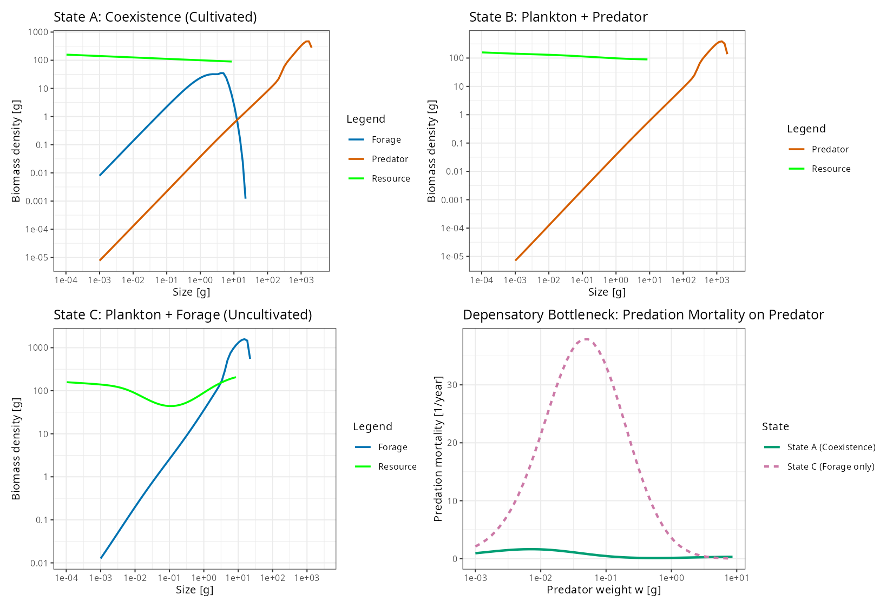

```{r setup, include=FALSE}
knitr::opts_chunk$set(
  echo = FALSE,
  message = FALSE,
  warning = FALSE,
  fig.align = "center",
  out.width = "100%"
)
```

# Introduction

A central paradox in marine fisheries ecology is the failure of several major piscivorous fish stocks—most notably Northwest Atlantic cod (*Gadus morhua*)—to recover following the imposition of strict fishing moratoria [@swain2000pelagic; @walters2001cultivation; @frank2005trophic]. Standard single-species stock--recruitment theory [@beverton1957dynamics] predicts that when recruitment is governed by compensatory density dependence, reducing fishing mortality ($F$) below the maximum sustainable yield threshold should allow a depleted population to rebound monotonically toward its unfished biomass. In many collapsed marine ecosystems, however, the depletion of large demersal predators was accompanied by an explosive increase in the biomass of small pelagic forage fishes (such as herring, sprat, capelin, and mackerel), which subsequently locked the ecosystem into an alternative, forage-fish-dominated regime [@swain2000pelagic; @frank2005trophic].

To explain these dynamics, @walters2001cultivation formulated the *cultivation--depensation hypothesis*. Under this mechanism, abundant adult piscivores "cultivate" a favorable nursery environment for their own offspring by top-down predation on small-bodied forage species. When selective fishing depletes the adult predator guild, forage fishes are released from predation control and expand to high abundances, where they prey directly upon—or compete intensely with—the eggs, larvae, and early juveniles of the large predator. The resulting survival bottleneck generates an emergent Allee effect (depensation) at the population level: once the predator falls below the biomass required to suppress its forage-fish prey, per-capita juvenile survival plummets and the predator is driven to local extinction.

While originally framed using age-structured single-species or coupled biomass models [@walters2001cultivation], cultivation--depensation is fundamentally a consequence of body-size structure and gape-limited trophic interactions [@deroos2002size; @vanleeuwen2008individual; @deroos2013population; @andersen2019fish]. In marine teleosts, both small forage fishes ($w_\infty \sim 10\text{--}50\text{ g}$) and large apex predators ($w_\infty \sim 10^3\text{--}10^4\text{ g}$) begin life as millimeter-scale pelagic eggs and larvae weighing roughly $w_{\min} \sim 10^{-3}\text{ g}$ [@andersen2006asymptotic; @hartvig2011food]. Because aquatic predators typically consume prey that are two orders of magnitude smaller in body mass ($\beta \sim 100\text{--}200$), a growing predator cohort must traverse the exact size window ($w \in [10^{-3}, 10^{-1}]\text{ g}$) where it falls squarely within the feeding kernel of adult forage fish ($w \in [1, 20]\text{ g}$). Only after surviving this early ontogenetic gauntlet and growing past $w \sim 50\text{--}200\text{ g}$ does the predator reverse the trophic relationship and begin preying upon the forage fish.

This ontogenetic role reversal has two major theoretical implications that we investigate in this paper:

1. **Sequential community assembly and priority effects**: In an unfished ecosystem, how can a three-taxa food web (plankton, forage fish, and large predator) assemble from a plankton-only baseline? If forage fish colonize first and establish a dense population, the larval predation gauntlet they create may prevent the large predator from ever invading. Conversely, if the large predator colonizes the plankton system first (utilizing plankton during its juvenile stages and smaller conspecifics or plankton at larger sizes), it establishes top-down control that may subsequently permit the forage fish to invade into a cultivated coexistence state.
2. **Selective versus balanced exploitation**: Fisheries have historically targeted large, high-value predators before expanding to lower trophic levels [@garcia2012reconsidering; @law2012balanced; @law2015size]. If selective exploitation of the predator triggers a collapse into an uncultivated forage-fish state that is uninvasible by the predator even at $F_{\text{Pred}} = 0$, then single-species conservation measures (such as a predator moratorium) are dynamically insufficient. Instead, harvesting the forage fish ($F_{\text{Forage}} > 0$) may be required both to *hold* an exploited predator in the ecosystem and to *re-open* the invasion window needed for predator recovery.

Here we construct a minimal, fully reproducible three-taxa size-spectrum model using the `mizer` framework [@scott2014mizer; @andersen2019fish] that captures all of these phenomena cleanly. We derive exact discrete invasion reproduction numbers ($R_0$) for each boundary equilibrium, verify local asymptotic stability via the linearized McKendrick--von Foerster operator, and map the complete two-parameter $(F_{\text{Forage}}, F_{\text{Pred}})$ bifurcation diagram.

# Model Formulation and Methods

## Dynamic Size-Spectrum Framework

We model a continuous size-structured marine community using the multispecies size-spectrum framework of @hartvig2011food and @andersen2019fish as implemented in `mizer` [@scott2014mizer]. The community consists of a background plankton resource spectrum $N_R(w, t)$ and two dynamic fish size spectra $N_i(w, t)$ ($i \in \{\text{Forage}, \text{Predator}\}$), where $N_i(w, t)\,dw$ represents the number of individuals in body-mass interval $[w, w + dw]$.

### Plankton Resource Dynamics

The plankton resource spectrum spans body masses from $w_{\min,R} = 10^{-6}\text{ g}$ up to $w_{\text{cut},R} = 10\text{ g}$ and obeys standard semichemostat dynamics in each size class:
\begin{equation}
  \frac{\partial N_R(w, t)}{\partial t} = r_R(w)\,\Big[c_R(w) - N_R(w, t)\Big] - \mu_{p,R}(w, t)\,N_R(w, t),
  (\#eq:resource)
\end{equation}
where $c_R(w) = \kappa\,w^{-\lambda}$ is the Sheldon carrying-capacity spectrum ($\kappa = 100\text{ g}^{\lambda - 1}$, $\lambda = 2 + q - n \approx 2.05$), $r_R(w) = r_0\,w^{n - 1}$ is the intrinsic mass-specific resource regeneration rate ($r_0 = 10\text{ g}^{1-n}\,\text{year}^{-1}$), and $\mu_{p,R}(w, t)$ is the predation mortality rate inflicted on plankton of size $w$ by all fish consumers.

### Fish Growth, Mortality, and Reproduction

For each fish species $i$ over its ontogenetic size range $[w_{\min,i}, w_{\infty,i}]$, the abundance density $N_i(w, t)$ satisfies the McKendrick--von Foerster conservation equation:
\begin{equation}
  \frac{\partial N_i(w, t)}{\partial t} + \frac{\partial \big[g_i(w, t)\,N_i(w, t)\big]}{\partial w} = -\mu_i(w, t)\,N_i(w, t).
  (\#eq:mvf)
\end{equation}

Predators of species $i$ and mass $w$ select prey of mass $w'$ according to a lognormal size-preference kernel:
\begin{equation}
  \phi_i(w / w') = \exp\!\left[-\frac{\big(\ln(w / (w'\,\beta_i))\big)^2}{2\,\sigma_i^2}\right],
  (\#eq:kernel)
\end{equation}
 parameterized by the preferred predator--prey mass ratio $\beta_i$ and feeding kernel width $\sigma_i$. Available prey biomass $E_{a,i}(w, t)$ combines the plankton resource and all fish spectra weighted by the species interaction matrix $\theta_{ij}$:
\begin{equation}
  E_{a,i}(w, t) = \int \phi_i(w / w')\,\left[N_R(w', t) + \sum_{j} \theta_{ij}\,N_j(w', t)\right] w'\,dw'.
  (\#eq:encounter)
\end{equation}
With search volume $\gamma_i\,w^q$ and maximum intake rate $h_i\,w^n$, the Holling type II feeding level is
\begin{equation}
  f_i(w, t) = \frac{\gamma_i\,w^q\,E_{a,i}(w, t)}{\gamma_i\,w^q\,E_{a,i}(w, t) + h_i\,w^n}.
  (\#eq:feeding)
\end{equation}
Assimilated energy (efficiency $\alpha = 0.6$) after metabolic maintenance $k_{s,i}\,w^p$ is partitioned between somatic growth $g_i(w, t)$ and reproduction according to the maturation ogive $\psi_i(w)$:
\begin{align}
  E_{r,i}(w, t) &= \max\!\Big(0,\; \alpha\,f_i(w, t)\,h_i\,w^n - k_{s,i}\,w^p\Big), (\#eq:er) \\
  g_i(w, t) &= E_{r,i}(w, t)\,\big[1 - \psi_i(w)\big]. (\#eq:growth)
\end{align}

Total mortality $\mu_i(w, t) = \mu_{p,i}(w, t) + \mu_{\text{ext},i}(w) + F_i\,S_i(w)$ comprises:

1. **Endogenous predation mortality** $\mu_{p,i}(w', t)$ inflicted by all fish species $j$:
   \begin{equation}
     \mu_{p,i}(w', t) = \sum_{j} \theta_{ji} \int \phi_j(w / w')\,\big[1 - f_j(w, t)\big]\,\gamma_j\,w^q\,N_j(w, t)\,dw,
     (\#eq:predmort)
   \end{equation}
2. **External background mortality** $\mu_{\text{ext},i}(w) = z_{0,i} + z_{\text{ext},i}\,(w / w_{\infty,i})^{n - 1}$, which combines a constant baseline $z_{0,i}$ with an allometric senescence/non-modeled-predation term $z_{\text{ext},i}$ that prevents unrealistic biomass pile-up near $w_{\infty,i}$, and
3. **Fishing mortality** $F_i\,S_i(w)$ with knife-edge gear selectivity $S_i(w) = \mathbb{I}(w \ge w_{\text{F},i})$.

At the recruitment boundary $w_{\min,i}$, the density-independent egg production rate is
\begin{equation}
  R_{\text{DI},i}(t) = \frac{1}{2}\,\frac{\epsilon_i}{w_{\min,i}} \int_{w_{\min,i}}^{w_{\infty,i}} E_{r,i}(w, t)\,\psi_i(w)\,N_i(w, t)\,dw,
  (\#eq:rdi)
\end{equation}
where $\epsilon_i$ is reproductive efficiency. Recruitment into the smallest size class follows a Beverton--Holt relationship [@beverton1957dynamics]:
\begin{equation}
  R_{\text{DD},i}(t) = \frac{R_{\text{DI},i}(t)}{1 + R_{\text{DI},i}(t) / R_{\max,i}},
  (\#eq:rdd)
\end{equation}
which fixes the boundary flux $g_i(w_{\min,i}, t)\,N_i(w_{\min,i}, t) = R_{\text{DD},i}(t)$. At the calibrated reference steady state (State A), the degree of recruitment compensation is parameterized by the dimensionless *reproduction level* $L_{R,i} = R_{\text{DD},i}^* / R_{\max,i} = 1 - 1 / R_{0,i}^* \in (0, 1)$.

## Community Parameterization

Table \@ref(tab:params-table) summarizes the parameters of the three-taxa model (`build_cultivation_model()` in `cultivation_depensation.R`). Both fish species recruit at $w_{\min} = 10^{-3}\text{ g}$. The **Forage** species grows rapidly ($k_{\text{vb}} = 1.0\text{ year}^{-1}$) to a small asymptotic size ($w_\infty = 20\text{ g}$, $w_{\text{mat}} = 4\text{ g}$) with a preferred predator--prey mass ratio $\beta_{\text{Forage}} = 200$ ($\sigma_{\text{Forage}} = 1.3$). Consequently, adult forage fish ($w \in [4, 20]\text{ g}$) have peak predation efficiency on prey weighing $w' = w / 200 \in [0.02, 0.10]\text{ g}$—directly overlapping the larval and early juvenile stages of the **Predator**.

The **Predator** grows to a large asymptotic size ($w_\infty = 2000\text{ g}$, $w_{\text{mat}} = 250\text{ g}$, $k_{\text{vb}} = 0.5\text{ year}^{-1}$) with $\beta_{\text{Predator}} = 100$ ($\sigma_{\text{Predator}} = 1.5$), so that maturing and adult predators ($w \in [200, 2000]\text{ g}$) feed preferentially on prey weighing $w' \in [2, 20]\text{ g}$—the juvenile and adult size classes of the forage fish. The interaction matrix is set to
\begin{equation}
  \boldsymbol{\theta} = \begin{pmatrix} \theta_{\text{For,For}} & \theta_{\text{For,Pred}} \\ \theta_{\text{Pred,For}} & \theta_{\text{Pred,Pred}} \end{pmatrix} = \begin{pmatrix} 0.05 & 0.95 \\ 1.00 & 0.05 \end{pmatrix},
  (\#eq:inter)
\end{equation}
reflecting strong interspecific trophic coupling ($\theta_{\text{Pred,For}} = 1.00$ for cultivation; $\theta_{\text{For,Pred}} = 0.95$ for larval predation) and weak intraspecific cannibalism ($\theta_{ii} = 0.05$). Separate knife-edge fishing gears with unit catchability (`catchability = 1`) target adult forage fish ($w \ge 1.0\text{ g}$, effort $F_{\text{Forage}}$) and adult predators ($w \ge 400.0\text{ g}$, effort $F_{\text{Pred}}$).

```{r params-table}
param_df <- data.frame(
  Parameter = c(
    "Asymptotic mass $w_\\infty$ [g]",
    "Maturation mass $w_{\\text{mat}}$ [g]",
    "Offspring mass $w_{\\min}$ [g]",
    "Preferred predator--prey mass ratio $\\beta$",
    "Feeding kernel width $\\sigma$",
    "von Bertalanffy growth rate $k_{\\text{vb}}$ [$\\text{year}^{-1}$]",
    "Initial feeding level $f_0$",
    "Baseline external mortality $z_0$ [$\\text{year}^{-1}$]",
    "Allometric external mortality $z_{\\text{ext}}$ [$\\text{year}^{-1}$]",
    "Calibrated State A biomass $B^*$ [g]",
    "State A reproduction level $L_R = R_{\\text{DD}}^* / R_{\\max}$",
    "Knife-edge fishing selectivity $w_{\\text{F}}$ [g]",
    "Interaction on Forage $\\theta_{i,\\text{Forage}}$",
    "Interaction on Predator $\\theta_{i,\\text{Predator}}$"
  ),
  Forage = c(
    "20", "4", "0.001", "200", "1.3", "1.0", "0.6",
    "0.30", "0.50", "94.31", "0.65", "1.0", "0.05", "0.95"
  ),
  Predator = c(
    "2000", "250", "0.001", "100", "1.5", "0.5", "0.6",
    "0.20", "1.20", "599.93", "0.78", "400.0", "1.00", "0.05"
  )
)
knitr::kable(
  param_df,
  booktabs = TRUE,
  escape = FALSE,
  caption = "Biological and fishery parameters for the dynamic fish species in the three-taxa cultivation--depensation model. Plankton resource parameters: $\\kappa = 100$, $r_0 = 10\\text{ year}^{-1}$, $w_{\\min,R} = 10^{-6}\\text{ g}$, $w_{\\text{cut},R} = 10\\text{ g}$."
)
```

## Steady-State Identification, Linear Stability, and Invasion Fitness ($R_0$)

Starting from the calibrated interior coexistence equilibrium (**State A**), we obtain the boundary equilibria under *identical* biological parameters (`get_fixed_points()` in `cultivation_depensation.R`):

- **State B** (Plankton + Predator): set $N_{\text{Forage}}(w, 0) = 0$ and project the PDE system to machine-precision convergence (`isSteady(params_B) == TRUE`).
- **State C** (Plankton + Forage fish): set $N_{\text{Predator}}(w, 0) = 0$ and project to convergence (`isSteady(params_C) == TRUE`).
- **State 0** (Plankton only): set $N_{\text{Forage}}(w, 0) = N_{\text{Predator}}(w, 0) = 0$ and $N_R(w, 0) = c_R(w)$ (`isSteady(params_0) == TRUE`).

Local asymptotic stability of each equilibrium within its resident subspace is evaluated using `getStability()`, which computes the leading eigenvalue $\lambda_{\max} = \max \operatorname{Re}(\lambda)$ of the Jacobian of the discretized PDE--resource system.

To determine whether an absent species $i$ can invade a resident boundary equilibrium (e.g., Forage invading State B, or Predator invading State C), we evaluate the exact discrete basic reproduction number $R_{0,i}$ (`get_R0()` in `cultivation_depensation.R`). Holding the resident growth rate $g_i(w)$ and total mortality rate $\mu_i(w)$ fixed at the target equilibrium, we solve the linear homogeneous steady-state transport equation for a unit initial abundance density $N_i(w_{\min,i}) = 1$ using `mizer:::get_steady_state_n()`, integrate the resulting lifetime density-independent egg output $R_{\text{DI},i}^{(1)}$, and divide by the discrete boundary flux $R_{\text{DD,req},i}^{(1)} = g_i(w_{\min,i}) + \mu_i(w_{\min,i})\,\Delta w_{\min,i}$:
\begin{equation}
  R_{0,i} = \frac{R_{\text{DI},i}^{(1)}}{R_{\text{DD,req},i}^{(1)}}.
  (\#eq:r0)
\end{equation}
By construction, at any interior Beverton--Holt equilibrium where species $i$ is present, Eq. \@ref(eq:rdd) implies $R_{0,i} = R_{\text{DI},i}^* / R_{\text{DD},i}^* = 1 / (1 - L_{R,i}) > 1$. At a boundary equilibrium where species $i$ is absent ($N_i \equiv 0$, so $R_{\text{DD},i} \approx R_{\text{DI},i}$ at infinitesimal density), a small introduction of species $i$ grows exponentially if and only if $R_{0,i} > 1$, and decays exponentially to extinction if and only if $R_{0,i} < 1$.

# Results

## Unfished Alternative Stable States and the Depensatory Bottleneck

In the absence of fishing ($F_{\text{Pred}} = 0, F_{\text{Forage}} = 0$), the model admits all four required equilibria (Table \@ref(tab:states-table); Figure \@ref(fig:fig-spectra)). Every fish-bearing equilibrium (`State A`, `State B`, and `State C`) satisfies `isSteady() == TRUE` and is locally asymptotically stable within its resident subspace ($\max\operatorname{Re}(\lambda) < 0$).

```{r states-table}
states_df <- data.frame(
  State = c("State 0", "State A", "State B", "State C"),
  Composition = c(
    "Plankton only",
    "Plankton + Forage + Predator",
    "Plankton + Predator",
    "Plankton + Forage"
  ),
  Forage_B = c("0.00", "94.31", "0.00", "2260.17"),
  Pred_B = c("0.00", "599.93", "536.71", "0.00"),
  R0_For = c("474.90", "2.89", "2.59", "111.86"),
  R0_Pred = c("9.31", "4.55", "3.59", "0.46"),
  Stable = c("No", "Yes", "Yes", "Yes"),
  Max_Eig = c("---", "-0.2832", "-0.2832", "-0.4570")
)
colnames(states_df) <- c(
  "State", "Resident Taxa", "$B_{\\text{For}}^*$ [g]", "$B_{\\text{Pred}}^*$ [g]",
  "$R_{0,\\text{For}}$", "$R_{0,\\text{Pred}}$", "Stable", "$\\max\\operatorname{Re}(\\lambda)$"
)
knitr::kable(
  states_df,
  booktabs = TRUE,
  escape = FALSE,
  align = "llrrrrcc",
  caption = "Summary of the four unfished fixed points ($F_{\\text{Pred}} = 0, F_{\\text{Forage}} = 0$) sharing identical biological parameters."
)
```

Comparing **State A** and **State C** reveals the quantitative mechanism of cultivation and depensation (Figure \@ref(fig:fig-spectra)):

- In **State A (Coexistence / Cultivated)**, the adult predator guild ($B_{\text{Predator}}^* = 599.93\text{ g}$) exerts strong top-down predation on the forage fish, holding forage-fish biomass down to $B_{\text{Forage}}^* = 94.31\text{ g}$. Because forage-fish abundance is low, the predation mortality inflicted on predator larvae ($w \in [10^{-3}, 1]\text{ g}$) remains mild ($\mu_{p,\text{Predator}} \le 1.6\text{ year}^{-1}$; Figure \@ref(fig:fig-spectra), bottom-right panel), allowing predator recruits to survive through the juvenile bottleneck and sustain $R_{0,\text{Predator}} = 4.55 > 1$.
- In **State B (Plankton + Predator)**, the predator persists on the plankton resource and weak conspecific predation at $B_{\text{Predator}}^* = 536.71\text{ g}$ ($R_{0,\text{Predator}} = 3.59 > 1$), leaving the plankton spectrum near its carrying capacity.
- In **State C (Plankton + Forage / Uncultivated)**, the absence of the predator releases the forage fish from top-down control. Forage-fish biomass surges $24$-fold to $B_{\text{Forage}}^* = 2260.17\text{ g}$, grazing a pronounced trough in the plankton spectrum around $w \in [0.02, 0.5]\text{ g}$ (Figure \@ref(fig:fig-spectra), bottom-left panel). This dense forage-fish population creates an intense predation gauntlet for small fish larvae: predation mortality on predator offspring peaks at $\mu_{p,\text{Predator}} \approx 37.3\text{ year}^{-1}$ around $w \approx 0.05\text{ g}$ (Figure \@ref(fig:fig-spectra), bottom-right panel). As a result, a rare predator attempting to recruit in State C achieves a lifetime reproductive output of only $R_{0,\text{Predator}} = 0.464 < 1$, rendering State C strictly uninvasible by the predator.

```{r fig-spectra, fig.cap="Unfished equilibrium size spectra and the depensatory mortality bottleneck. Top left: Coexistence State A, where adult predators suppress forage fish. Top right: Plankton--predator State B. Bottom left: Plankton--forage State C, where release from predator control allows forage fish biomass to expand 24-fold and graze down the plankton spectrum. Bottom right: Predation mortality rate $\\mu_{p,\\text{Predator}}(w)$ experienced by early life stages of the predator ($w \\le 10\\text{ g}$) in State A (solid green) versus State C (dashed magenta)."}

```

## Priority Effects and Sequential Community Assembly

The invasion reproduction numbers in Table \@ref(tab:states-table) establish a directional hierarchy for community assembly from the plankton-only baseline (**State 0**):

1. Both fish species can invade **State 0** ($R_{0,\text{Forage}} = 474.90 > 1$, $R_{0,\text{Predator}} = 9.31 > 1$).
2. If the **Predator** colonizes first (**State 0 $\to$ State B**), the resulting plankton--predator subsystem is invasible by the **Forage** fish ($R_{0,\text{Forage}}(\text{State B}) = 2.59 > 1$). Introducing a trace density of forage fish ($10^{-3}\times$ State A abundance) into State B leads to rapid exponential growth of the forage fish and smooth convergence to the three-taxa coexistence equilibrium **State A** (Figure \@ref(fig:fig-invasions)A), slightly boosting predator biomass from $536.7\text{ g}$ to $599.9\text{ g}$ as adult predators gain access to forage-fish prey.
3. Conversely, if the **Forage** fish colonizes first (**State 0 $\to$ State C**), community assembly arrests at the two-taxa subsystem **State C**. Introducing a seed population of predators ($10^{-2}\times$ State A abundance) into State C fails: after a brief initial transient, the predator cohort is wiped out by larval predation from the forage fish and decays exponentially toward zero at rate $\approx -0.065\text{ year}^{-1}$ ($R_{0,\text{Predator}}(\text{State C}) = 0.464 < 1$; Figure \@ref(fig:fig-invasions)B).

Thus, unfished parameter space is bistable between **State A** and **State C**, and assembling the full three-taxa food web without external intervention requires the large predator to establish prior to the forage fish.

```{r fig-invasions, fig.cap="Community assembly and mutual invasion experiments in the absence of fishing ($F_{\\text{Pred}} = 0, F_{\\text{Forage}} = 0$). (A) Introducing a trace population of forage fish into the plankton--predator equilibrium (State B) results in successful invasion ($R_{0,\\text{Forage}} = 2.59 > 1$) and convergence to the three-taxa coexistence equilibrium (State A). (B) Introducing a seed population of predators into the plankton--forage equilibrium (State C) fails ($R_{0,\\text{Predator}} = 0.46 < 1$), as intense predation by forage fish on predator larvae drives the invading predator exponentially to extinction."}
knitr::include_graphics("plots/assembly_invasions.png")
```

## Selective Predator Exploitation and Catastrophic Collapse

We next examine the response of the three-taxa coexistence state (**State A**) to selective exploitation of the adult predator ($w \ge 400\text{ g}$) at tunable fishing mortality rate $F_{\text{Pred}}$ (Figure \@ref(fig:fig-bifurcation)).

When the forage fish is unexploited ($F_{\text{Forage}} = 0$, solid curves in Figure \@ref(fig:fig-bifurcation)):

- **Low to moderate predator fishing ($0 \le F_{\text{Pred}} \le 0.175\text{ year}^{-1}$)**: The interior fixed point **State A** remains locally stable and shifts gradually. As $F_{\text{Pred}}$ increases from $0$ to $0.175\text{ year}^{-1}$, equilibrium predator biomass declines from $599.9\text{ g}$ to $386.6\text{ g}$, partially releasing the forage fish whose biomass increases from $94.3\text{ g}$ to $327.0\text{ g}$.
- **Threshold collapse ($F_{\text{Pred}} > F_{\text{crit}} \approx 0.188\text{ year}^{-1}$)**: Above $F_{\text{crit}}$, the remaining adult predator biomass can no longer suppress the forage-fish population below the threshold where larval predation mortality overwhelms compensatory predator recruitment ($R_{0,\text{Predator}}$ drops below $1$). A saddle-node (fold) bifurcation annihilates the interior coexistence equilibrium, driving the predator to extinction ($B_{\text{Predator}}^* \to 0$) and causing forage-fish biomass to jump abruptly to the **State C** plateau ($B_{\text{Forage}}^* = 2260.2\text{ g}$).

In contrast, when exploitation is balanced by simultaneously harvesting the forage fish at $F_{\text{Forage}} = 0.35\text{ year}^{-1}$ (dashed curves in Figure \@ref(fig:fig-bifurcation)), fishing mortality directly restrains forage-fish expansion as the predator is fished down. Consequently, the exploited predator is held in the ecosystem far past the unbalanced collapse threshold, persisting up to $F_{\text{Pred}} \approx 0.29\text{ year}^{-1}$.

```{r fig-bifurcation, fig.cap="Equilibrium biomass of Forage fish (blue) and Predator (orange) as a function of predator fishing mortality $F_{\\text{Pred}}$, starting from Coexistence State A. Solid lines show unbalanced exploitation targeting only the predator ($F_{\\text{Forage}} = 0$): State A persists up to the critical fold threshold $F_{\\text{crit}} \\approx 0.19\\text{ year}^{-1}$ (vertical dotted line), above which the predator collapses to zero and the community jumps to State C. Dashed lines show balanced exploitation with concurrent forage-fish harvesting ($F_{\\text{Forage}} = 0.35\\text{ year}^{-1}$), which prevents the forage-fish outbreak and holds the exploited predator in the ecosystem."}
knitr::include_graphics("plots/predator_exploitation_bifurcation.png")
```

## Hysteresis Under Moratorium and Recovery via Forage-Fish Harvesting

To illustrate the management consequences of cultivation--depensation, Figure \@ref(fig:fig-hysteresis) tracks a five-phase management trajectory over $570\text{ years}$:

1. **Phase 1 (Years 0--50, Unfished Coexistence)**: The community resides at the unfished **State A** equilibrium ($B_{\text{Predator}} = 599.9\text{ g}$, $B_{\text{Forage}} = 94.3\text{ g}$).
2. **Phase 2 (Years 50--200, Predator Overfishing $\to$ Collapse)**: Selective predator fishing above the fold threshold ($F_{\text{Pred}} = 0.25\text{ year}^{-1}, F_{\text{Forage}} = 0$) triggers a trophic cascade: as adult predators decline, forage fish surge to $2260\text{ g}$, accelerating the collapse of the predator into **State C**.
3. **Phase 3 (Years 200--320, Predator Moratorium Fails)**: At Year 200, a complete moratorium on predator fishing is enacted ($F_{\text{Pred}} = 0, F_{\text{Forage}} = 0$) and a re-introduction seed of predators ($0.5\%$ of State A abundance) is added. Because the ecosystem is trapped in the basin of attraction of **State C** where $R_{0,\text{Predator}} = 0.464 < 1$, the introduced predators cannot overcome larval predation by the uncultivated forage fish and decay exponentially back toward extinction.
4. **Phase 4 (Years 320--470, Forage-Fish Harvesting Enables Re-Entry)**: At Year 320, managers initiate a targeted fishery on the forage fish ($F_{\text{Forage}} = 0.30\text{ year}^{-1}, F_{\text{Pred}} = 0$) alongside a predator seed. Harvesting the forage fish reduces its equilibrium biomass in State C from $2260.2\text{ g}$ down toward $1534.4\text{ g}$, lowering larval predation mortality enough to raise predator invasion fitness to $R_{0,\text{Predator}} = 2.02 > 1$. The predator successfully invades, grows exponentially over $\sim 60\text{ years}$, and re-establishes top-down cultivation over the forage fish.
5. **Phase 5 (Years 470--570, Self-Sustaining Restoration)**: At Year 470, forage-fish harvesting is halted ($F_{\text{Forage}} = 0, F_{\text{Pred}} = 0$). Because the restored predator population now maintains top-down control on the forage fish, the community remains permanently at the unfished coexistence equilibrium **State A**.

```{r fig-hysteresis, fig.cap="Five-phase time-series simulation demonstrating irreversible predator collapse under single-species management and recovery via forage-fish harvesting. Phase 1 (Years 0--50): Unfished Coexistence State A. Phase 2 (Years 50--200): Selective predator overfishing ($F_{\\text{Pred}} = 0.25\\text{ year}^{-1}, F_{\\text{Forage}} = 0$) drives the predator to collapse and releases forage fish to State C. Phase 3 (Years 200--320): A complete predator moratorium ($F_{\\text{Pred}} = 0, F_{\\text{Forage}} = 0$) with predator seeding fails because State C is uninvasible ($R_{0,\\text{Predator}} = 0.46 < 1$). Phase 4 (Years 320--470): Harvesting the forage fish ($F_{\\text{Forage}} = 0.30\\text{ year}^{-1}$) raises $R_{0,\\text{Predator}} = 2.02 > 1$, enabling the predator to re-enter and suppress the forage fish. Phase 5 (Years 470--570): Removing all fishing ($F_{\\text{Pred}} = 0, F_{\\text{Forage}} = 0$) leaves Coexistence State A self-sustaining."}
knitr::include_graphics("plots/hysteresis_and_recovery.png")
```

## Two-Parameter Exploitation Phase Diagram and Cusp Bifurcation

To generalize these results across all combinations of fishing effort, we compute the predator's invasion reproduction number $R_{0,\text{Predator}}(\text{State C})$ as a function of $F_{\text{Forage}}$ (Figure \@ref(fig:fig-regime)A) and map the complete two-parameter bifurcation diagram in the $(F_{\text{Forage}}, F_{\text{Pred}})$ plane (Figure \@ref(fig:fig-regime)B).

In **State C**, increasing $F_{\text{Forage}}$ monotonically reduces uncultivated forage-fish biomass and increases $R_{0,\text{Predator}}$ from $0.464$ (at $F_{\text{Forage}} = 0$) across the invasion threshold $R_{0,\text{Predator}} = 1$ at the critical forage-fish harvest rate
\begin{equation}
  F_{\text{Forage,inv}} = 0.128\text{ year}^{-1} \quad \big(B_{\text{Forage}}^*(\text{State C}) \approx 1895\text{ g}\big),
  (\#eq:ff-inv)
\end{equation}
reaching $R_{0,\text{Predator}} = 3.44$ at $F_{\text{Forage}} = 0.50\text{ year}^{-1}$ (Figure \@ref(fig:fig-regime)A).

In the two-parameter $(F_{\text{Forage}}, F_{\text{Pred}})$ plane (Figure \@ref(fig:fig-regime)B), two bifurcation curves organize the community dynamics:

1. **The fold / collapse boundary $F_{\text{crit}}(F_{\text{Forage}})$** (solid orange curve), above which the interior coexistence state **State A** ceases to exist, and
2. **The transcritical invasion boundary $F_{\text{inv}}(F_{\text{Forage}})$** (dashed green curve), defined implicitly by $R_{0,\text{Predator}}\big(\text{State C}(F_{\text{Forage}}, F_{\text{Pred}})\big) = 1$, below which **State C** becomes unstable to predator invasion.

These two boundaries partition exploitation space into three distinct regimes and meet tangentially at a **codimension-2 cusp bifurcation** at $(F_{\text{Forage}}, F_{\text{Pred}}) \approx (0.35, 0.292)\text{ year}^{-1}$:

- **Bistable Cultivation--Depensation Regime (amber wedge)**: For $0 \le F_{\text{Forage}} < 0.35\text{ year}^{-1}$ and $\max(0, F_{\text{inv}}(F_{\text{Forage}})) < F_{\text{Pred}} < F_{\text{crit}}(F_{\text{Forage}})$, both **State A** and **State C** are locally stable. An established predator population persists via top-down cultivation, but if overfishing pushes the system across $F_{\text{crit}}$, the predator cannot re-invade without shifting $(F_{\text{Forage}}, F_{\text{Pred}})$ across the dashed transcritical boundary. Notably, for $F_{\text{Forage}} < 0.128\text{ year}^{-1}$, the bistable region extends all the way down to $F_{\text{Pred}} = 0$, explaining why a predator moratorium alone cannot achieve recovery.
- **Monostable Coexistence Regime (green region)**: For $F_{\text{Forage}} > 0.128\text{ year}^{-1}$ and $F_{\text{Pred}} < F_{\text{inv}}(F_{\text{Forage}})$, forage-fish harvesting sufficiently weakens the larval predation gauntlet that **State C** is unstable to predator invasion ($R_{0,\text{Predator}} > 1$). Here **State A** is the unique stable attractor when both fish species are present, guaranteeing predator recovery from arbitrarily low densities.
- **Forage-Dominated Regime (blue region)**: Above $\max(F_{\text{crit}}, F_{\text{inv}})$, direct fishing mortality on the predator exceeds its reproductive capacity even under cultivated conditions, leaving **State C** as the unique stable attractor.

```{r fig-regime, fig.cap="Two-parameter exploitation analysis across $(F_{\\text{Forage}}, F_{\\text{Pred}})$. (A) Predator invasion reproduction number $R_{0,\\text{Predator}}$ in the uncultivated plankton--forage state (State C) as a function of forage-fish fishing mortality $F_{\\text{Forage}}$ (at $F_{\\text{Pred}} = 0$); State C becomes invasible ($R_{0,\\text{Predator}} > 1$) above $F_{\\text{Forage,inv}} = 0.128\\text{ year}^{-1}$. (B) Two-parameter regime diagram in $(F_{\\text{Forage}}, F_{\\text{Pred}})$ space showing the Bistable Regime (amber), the Monostable Coexistence Regime (green), and the Forage-Dominated Regime (blue), bounded by the saddle-node fold curve $F_{\\text{crit}}(F_{\\text{Forage}})$ (solid orange) and the transcritical invasion curve $R_{0,\\text{Predator}}(\\text{State C}) = 1$ (dashed green), which merge at a codimension-2 cusp point at $(0.35, 0.292)\\text{ year}^{-1}$."}
knitr::include_graphics("plots/regime_diagram_2D.png")
```

# Discussion

## Size-Structured Ontogeny as the Engine of Cultivation--Depensation

Our model demonstrates that cultivation--depensation does not require bespoke functional forms or ad-hoc depensatory stock--recruitment terms: it emerges directly from standard size-spectrum bioenergetics [@hartvig2011food; @scott2014mizer; @andersen2019fish] whenever a small-bodied forage species and a large-bodied predator share a common milligram recruitment size and interact via gape-limited predation. The key ecological condition is that the uncultivated forage-fish equilibrium (**State C**) achieves a high enough biomass density on the Sheldon scale of the plankton resource that the predation mortality inflicted by adult forage fish on predator larvae ($\mu_{p,\text{Predator}} \sim 37\text{ year}^{-1}$ at $w \sim 0.05\text{ g}$) exceeds the compensatory reserve of predator recruitment ($L_{R,\text{Predator}} = 0.78$, corresponding to an unfished cultivated $R_{0,\text{Predator}} = 4.55$). When the adult predator is present (**State A**), top-down predation holds forage-fish biomass down by a factor of $24$, reducing larval predation mortality to $\sim 1.5\text{ year}^{-1}$ and maintaining a wide safety margin for predator recruitment.

## Priority Effects in Size-Spectrum Community Assembly

A striking consequence of this ontogenetic asymmetry is the directional assembly rule linking the boundary equilibria (**State 0**, **State B**, and **State C**) to the interior coexistence state (**State A**). In classical Lotka--Volterra intraguild predation models, an intermediate consumer (forage fish) must be a superior exploiter of the basal resource to coexist with an intraguild predator, and assembly typically proceeds from basal resource to consumer to predator. In a size-structured marine food web where all teleosts spawn at $w_{\min} \sim 10^{-3}\text{ g}$, the reverse assembly order can be required: the large predator can colonize the plankton-only system first (**State 0 $\to$ State B**) and subsequently facilitate—or tolerate—the invasion of the forage fish (**State B $\to$ State A**, $R_{0,\text{Forage}} = 2.59 > 1$), whereas early colonization by the forage fish (**State 0 $\to$ State C**) erects a larval predation barrier that blocks predator entry ($R_{0,\text{Predator}} = 0.46 < 1$). This provides a mechanistic size-spectrum explanation for priority effects and alternative community states in marine food webs [@deroos2002size; @vanleeuwen2008individual; @deroos2013population].

## Why Exploitation Must Be Balanced Across Species

From a fisheries management perspective, the two-parameter regime diagram (Figure \@ref(fig:fig-regime)B) provides a clear dynamical justification for balanced harvesting across trophic guilds [@garcia2012reconsidering; @law2012balanced; @law2015size]:

1. **Vulnerability of unbalanced, apex-focused fisheries**: When fishing targets only the large predator ($F_{\text{Forage}} = 0$), the fishery operates along the vertical axis of Figure \@ref(fig:fig-regime)B—entirely inside the bistable cultivation--depensation regime. Not only is the maximum sustainable predator fishing mortality comparatively low ($F_{\text{crit}} \approx 0.188\text{ year}^{-1}$), but any overshoot of $F_{\text{crit}}$ triggers an irreversible collapse into **State C** from which a single-species moratorium ($F_{\text{Pred}} = 0$) cannot recover the stock.
2. **Preventative stabilization via forage harvesting**: Applying moderate fishing mortality to the forage fish ($F_{\text{Forage}} \in [0.15, 0.35]\text{ year}^{-1}$) shifts the fishery rightward in Figure \@ref(fig:fig-regime)B, raising the predator collapse threshold $F_{\text{crit}}(F_{\text{Forage}})$ by more than $50\%$ (from $0.188$ to $0.292\text{ year}^{-1}$ at the cusp point) and progressively narrowing the bistable hysteresis zone. Beyond the cusp point ($F_{\text{Forage}} \ge 0.35\text{ year}^{-1}$), the fold bifurcation disappears altogether, replacing catastrophic collapse with a smooth, reversible transcritical transition.
3. **Trophic restoration of collapsed predators**: When an ecosystem is already locked in the uncultivated forage-fish regime (**State C**), harvesting the forage fish above $F_{\text{Forage,inv}} = 0.128\text{ year}^{-1}$ acts as an artificial substitute for the missing adult predator's cultivation service. Once the predator re-invades and rebuilds its adult biomass, it resumes top-down control over the forage fish, allowing the system to remain in **State A** even if forage-fish harvesting is subsequently reduced.

## Reproducibility

All model construction, steady-state verification, linear stability analysis, exact discrete $R_0$ calculations, and figure generation are implemented in `cultivation_depensation.R`, with the calibrated `MizerParams` object archived in `cultivation_depensation_params.rds`.

# References
